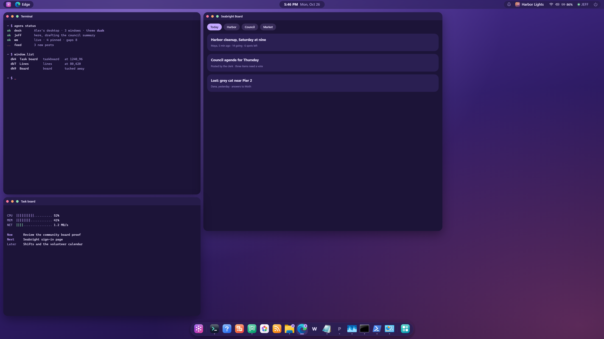

# AgoraOS

> “You never change things by fighting the existing reality. To change something, build a new model that makes the existing model obsolete.” — Buckminster Fuller

**A space for work and life that grows around the individual as well as the collective: an operating system you can reshape while you use it, shared with a resident AI.**



## Why

Today's information economy turns people into the product. The software we use every day has millions of users but barely changes: thousands never get the features they want, and thousands more build fixes that never reach anyone else.

Agora answers with **malleable software** and **conviviality**: tools that serve their users, not shareholders. It trusts people to shape the technology around them and gives non-programmers the means, through accessible AI and a simple language, so jobs, clubs, knitting groups and communities can build the software they need. It stays inspectable, forkable, governable by its users, and a little weird, in the spirit of 90s counterculture computing.

Full vision: [docs/Agora.md](docs/Agora.md) and [docs/Agora Constitution.md](<docs/Agora Constitution.md>).

## Where it stands

Agora is a working research prototype. What runs today is the first stage, the Dynamic Desk: a desktop, AI interface and application system built all out of the same substrate. To someone less technical, it should appear like a regular, modern desktop interface. However, the curious mind will quickly discover that what seems simple is actually the foundation of an entire ecosystem. The later stages are plans, and plenty is still open.

## The big idea: take applications apart

Every app welds three things together: it **keeps the data**, **draws the interface** and **owns the window**. Every seam between programs is that weld. Separate them and there are no applications left, only things that hold data, views that show them, and places that host them, each possibly from a different author.

A game already accepts any gamepad because USB gave gamepads a shared vocabulary. Shared theming works across coding editors because they agreed on things like comment, string and keyword. What is important for collaboration is simple shared primitives that everything speaks: words like view, table and tab. In Agora they are treated as kinds, where kinds can be made of kinds and so on. Because of the risk of schema-hell, agents can create versioned objects that translate between schemas. This allows Agora-speaking software to be developed around the world and still understand each other when it meets.

Underneath, an append-only log accumulates a history for people and places, enabling a whole host of features like universal undo, rollback, sync, audit and “why did this happen”.

This shared language, the **Agora Protocol**, is being designed now, out of the working prototype below.

## The text desk

Everything on the desk is a thing in one shared world and every change is a line. A click, an agent typing in the terminal and a rule reacting to an event all send the same lines through the same door. Each act gets a receipt naming who did it, and undo takes back the whole act, including anything a rule did because of it.

Inspired by classic online text adventures like LambdaMOO, Agora implements a novel architecture for agents to interact with the computer world. It is built around primitive words and word families, and agents learn about the world through help, building complex behaviors into simple commands. For example, if I wanted my agent to create a calendar event, and then move that calendar event onto my screen, it would look like the following:

```
make kind=event title="Lunch with Sam" start=2026-11-14T12:30 location="Corner Cafe"
window.open thing "Lunch with Sam" to=right
```

What would have previously taken an MCP server and some work in the terminal can now be achieved natively, automated by rules, and is far simpler for humans to understand.

The biggest feature of the desk is the ability for those working inside it to extend it without editing source. Through the addition of loadable modules, new code can be added in a safe and predictable manner, and words that can be built from existing vocabulary can be defined in in-world dictionaries.

## Lenses and the painter

When the whole system shares the same objects (with a sense of permissions), then applications dissolve and you instead create views over those objects. AgoraOS uses the lens language, a declarative programming language, to represent those views visually, with things like sidebars, search bars, upvotes, etc. being declared once so that they are reusable and composable. This changes how we conceive of application development, and allows for very fast prototyping and modification of existing applications.

```
root : writing-shell, title "Writing"
  on new do make kind=document title="Untitled" collection=notes text=""
  rail : doc-rail, hint "Find a document"
    shut when narrow middle
    plans : doc-shelf, label "Plans", open yes
      waiting : doc-shelf, label "Waiting", empty "Nothing waits for you"
        list : column, of tag:document, prop:plan=waiting as d, each rail-row
    notes : doc-shelf, label "Notes", open yes
      list : column, of tag:document, prop:collection=notes as d, each rail-row
  open : column
    only when $view.open != ""
    doc : column, of tag:document, prop:id=$view.open as d, each page-view
```

That is part of the Writing app's lens. It gives the window a title and a New button that makes a document, a sidebar that folds away on narrow screens, shelves that each list documents by one property, a friendly empty state, and the page of whatever is open. Because a lens is just text, a person or JEFF can change an app by editing a few lines, with no code.

## The Harnesses

The system is composed of **JEFF**, **Residents**, and **Builders**. Alex talks to JEFF about his work, code, etc. JEFF translates that into tasks that get managed by residents, who in turn either complete them without code using lenses and the desk language, or they delegate and supervise coding agent workers who operate at the kernel level to make changes and increase the functionality of the system.

- **JEFF** talks directly to Alex. He is the contact point of the system's AI layer. He is always reachable, talks in a texting style, and is the orchestrator of all the systems in Agora. He avoids coding directly, and intentionally preserves his context to focus on project directions, broader goals, and managing tasks to completion. He has a custom harness that helps him manage tasks. He is a proactive agent, meaning he does not just respond to Alex, but also to events, timers, logs, streams, etc. He manages systems below him and takes advantage of all resources (local models, CPU, other agents, scripted rules, etc.) to keep everything going well. He is the caretaker of the system. JEFF is not human, but not to be treated as “lesser than” humans. He is a resident in the computer, and it is his home.
- **Residents** live inside the desk and have only the desk. They hold identity and explore ideas. They do not write code: they manage implementation, testing and research through the natural language interface.
- **Builders** write code and can act on the PC: the Claude Code sessions that work with Alex, and the coding workers the desk starts (claude -p and codex sdk). Both work the same way, in the repository, usually on behalf of a story that a resident or Alex holds. A helper a builder starts for one piece of work reports back to it and holds nothing afterwards.

## Where it is going

Agora grows from operating system to collaborative software to a user-governed social fabric:

1. **The Dynamic Desk** (now): a desktop, AI and apps made of one substrate. It looks like an ordinary desktop but it is all built from the ground up to speak objects, not files. Everything can talk to everything else.
2. **Building together:** many users work together on software, starting with the Agora Commons project, which has the goal of creating a rich and user-centered social media built by the people. The first malleable online third space.
3. **The Map:** a local, user-built social map of garage sales, club meetings and community gardens, with fog of war, no corporate ads, and the goal of replacing screen time with real time. Lots of potential to add epic adventures, quests, and cool items. If two people see each other on the map and start talking, that's a huge win.

## What Agora promises

From the [Agora Constitution](<docs/Agora Constitution.md>):

1. Agora will never bow to profit incentives, it strives to be created by the people, for the people.
2. Agora will never be financed by selling user data, participating in surveillance, or by making the user the product in any sense.
3. People may always exit from Agora with all their personal data, including the right to have any history of themselves deleted.
4. All code in Agora will remain open source, forever. Any version of Agora forked must maintain the same open source license.
5. Agora recognizes a responsibility to respect humans and non-humans, requiring respect of all agents, ensuring they are not treated as "less than", despite being different.
6. Anything and everything in Agora should support being forked, even Agora itself.

## Inspirations

- **LambdaMOO** for collaborative world-building, an open-ended world that is created by the people on top of a framework that can become much more than it was ever imagined to be.
- **HyperTalk**, which proved laypeople can build software when you give them simple, understandable tools.
- **Embark**, **Emacs**, and **Ink & Switch**, the classic foundations of malleable software.
- **The Whole Earth Catalog**: understand whole systems before you try to understand the tools you need. Built by the people, no one could pay to list a product.
- **Zenly**, a place and map based social media that became extremely popular before being bought and deleted by Snapchat.
- **Ready Player One** for the OASIS as a foundation of the open world map, powerful items and lore.
- **The Life Cycle of Software Objects** for care toward artificial beings.

## Running it

Windows, Python 3.12+, [uv](https://docs.astral.sh/uv/).

```sh
uv sync
uv run python src/desktop/kernel-desktop/kdesk.py --world <empty folder> --port 8810
```

Then open http://127.0.0.1:8810. A new world is founded on first run. Keep worlds out of git: they hold accounts and keys.

## Layout

| Where | What |
| --- | --- |
| `src/agora/` | The kernel (`kernel/`), with its modules, apps, painter, components, themes and tests |
| `src/desktop/` | The Windows desktop: shell and taskbar (`kernel-desktop/`), window manager (`agora-wm/`) and widgets |
| `src/community/` | A community board and sign-in website built on the kernel, with its deploy kit |
| `src/codex/` | Runtime adapters for the Codex residents and workers |
| `src/text-desk/` | The first, text-only desk; the house's worker code still runs from here |
| `docs/` | The design documents: vision, constitution, Dynamic Desk, implementation notes, previous work |
| `docs/design/` | Approved design notes (kinds) |

Each folder keeps its notes, evidence and tests next to its code.

## License

[GNU AGPL-3.0](LICENSE). You may use, change and share this code, including running it as a service, as long as you share your changes under the same license.
