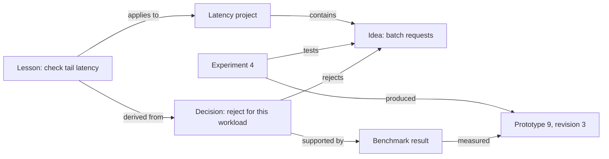
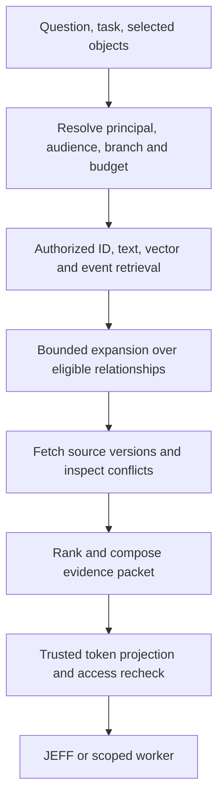

# Connecting Agora's objects into useful memory

Research proposal · 31 August 2026

**Scope correction:** this first-pass proposal focuses too narrowly on project decisions and experiments to define all of Agora memory. Read the [[operating-system-memory|OS-wide reframing]] first. It supersedes the framing and first-prototype recommendation here; the evidence, authority, temporal and storage considerations below remain supporting design work.

**Recommendation:** build an object-centered, evidence-preserving memory service. Keep Agora entities as the identity system; add qualified relationship records and composable memory facets; record native work connections directly; use models to propose additional connections; retrieve small, authorized subgraphs together with their source evidence. Start with an embedded relational store and rebuildable indexes. Do not choose a graph database as a substitute for these contracts.

Everything described as a recommendation below is a proposed design, not existing behavior. The six-field entity core remains unchanged.

## 1. What Agora already gives us

| Existing commitment | Consequence for memory | Source |
| --- | --- | --- |
| Stable identity plus independently versioned facets; kind tags are advisory | Refer to the same prototype from a conversation, experiment, and decision; express memory features as facets | [[Agora Objects (superseded)|Objects, §§3–5]] |
| Relationships are first-class records with asserter and event | Extend the edge contract rather than invent a separate identity graph | [[Agora Objects (superseded)|Objects, §6]] |
| Facets project into a token budget | Retrieval must select both objects and detail levels, including provenance overhead | [[Agora Objects (superseded)|Objects, §7]] |
| Event log is authoritative; indexes are disposable | Record accepted extraction outputs; replay must not call a model to recreate the past | [[Agora Objects (superseded)|Objects, §11]] |
| World rollback does not erase JEFF's memory | Current-state retrieval and historical recollection need different branch semantics | [[Agora Spec|Core, §§11–13]] |
| Spatial and semantic graphs are different | Visual proximity can suggest a connection but cannot define semantic truth | [[Agora Spec|Core, §5]] |
| Rooms share selected objects; personal memory is confidential | One logical graph does not mean one undifferentiated memory pool | [[Rooms|Rooms, §§2, 5–6]] |
| Protected services mediate memory, disclosure, and effects | A relationship or remembered approval cannot confer authority | [[Security|Security, §§3–4]] |

Three claims in the existing documents need narrowing. An event can faithfully record a false observation. A model reading loose semantics cannot make that semantics safe for authorization. A history of file-change events cannot reconstruct file contents unless the corresponding versions are retained. These are contract requirements, not graph algorithm choices.

## 2. Define usefulness before connectivity

The system should support several distinct jobs:

| Person's question | Necessary memory | Expected result |
| --- | --- | --- |
| “Where did we leave off?” | Active project, last checkpoint, unfinished commitments, changed objects | Briefing with resumable work and current state |
| “Why is this built this way?” | Decision, alternatives, evidence, participants, versions | Traceable rationale with any later supersession |
| “Didn't we try this before?” | Experiment, environment, outcome, failed branch | Applicable warning, not a blanket prohibition |
| “What else might solve this?” | Related mechanisms across authorized projects | A small number of explained analogies |
| “What will this change affect?” | Declared dependencies and versioned observations | Affected objects with distinction between known and possible impact |
| “What should I give this worker?” | Task-scoped facts, constraints, relevant attempts | Bounded context plus separately issued grants |
| “Why do you believe that?” | Claims, exact source versions, transformations | Evidence trail, uncertainty, and a correction control |
| “Forget that” | Source and all dependent derivatives | Managed deletion outcome with honest limits |

Graph density, number of stored facts, and the attractiveness of a graph visualization are not success metrics. The main outcomes are less repeated explanation, fewer repeated mistakes, faster correct resumption, and useful connections the person would otherwise miss.

## 3. One identity system, several different meanings

Use a shared reference language across separately governed stores. Distinguish these logical layers:

1. **World state:** objects and facets at a particular branch and revision. A process being healthy is an observation with a freshness limit, not a timeless memory.
2. **Episodes:** bounded work sessions or events with participants, inputs, outputs, and outcomes. Episodes group events; they do not replace the event log.
3. **Claims and decisions:** statements about objects, their evidence, applicability, and disagreement. Accepted decisions and model suggestions remain distinguishable.
4. **Derived retrieval aids:** embeddings, summaries, clusters, salience, candidate links, and traversal indexes. These may improve access without becoming authoritative facts.

Procedural memory fits as an object carrying a procedure facet: preconditions, steps or artifact reference, expected outcomes, evidence from prior runs, and known limitations. A successful procedure does not receive execution rights merely because it was remembered. Prospective memory fits as commitment facets: goal, owner, triggering condition, due state if provided, and completion evidence. Neither requires a new entity class.

JEFF can maintain personal interpretations of room events without publishing them to the room. A project is an entity and a useful retrieval scope, not automatically an access-control boundary. An object can belong to several projects; private facets of a shared object remain private.

### A concrete example

Illustrative future Agora data, not a record of something Alex has done:



On resumption, JEFF should say that batching was rejected under a particular workload because a particular measurement worsened. It should show the result and the decision. If the workload has changed, it should flag that the lesson may no longer apply. If the experiment was rolled back, it should not claim the prototype is running.

This is the useful connection: an idea leads to an attempt, an observed outcome, a decision, and a condition on future work. Simply linking everything to “latency” loses most of that value.

## 4. How connections enter the graph

### 4.1 Record the connections work already knows

The object/action service should emit structural links as part of validated operations. Creating an experiment from a selected idea already supplies both IDs. A worker completion already knows its task, input versions, output objects, and result receipts. A comment attached to a code selection already knows the code object and selection revision.

Create these links without a language model: `part_of`, `input_to`, `produced`, `derived_from`, `tests`, `attached_to`, and explicit human connections. For an operation committed within one authority domain, commit its object updates, relationship records, and event atomically. Cross-domain observations arrive through an authenticated, idempotent import protocol rather than pretending there is one global transaction.

Structural capture does not prove the worker's conclusion. “Worker 52 submitted result R” can be verified as an operation. “R proves the system is safe” remains a claim requiring evidence.

### 4.2 Import with exact anchors

Use native entity IDs whenever available. For imported resources, map provider namespace plus stable provider ID to a local entity; a filename or display name is not a unique identity. Preserve versions and selectors: document paragraph, audio time span, image region, table range, or code symbol plus commit and source span. A moving line number alone is insufficient.

Content hashes identify versions, not necessarily conceptual objects: two independently owned objects may contain identical bytes. File rename tracking and replacement at the same path need distinct handling. A content digest is also not a read grant.

For images, recordings, and other opaque media, attach model descriptions as derived observations with modality and extractor provenance. Retain the source when permitted. Model captions must not silently replace the original evidence.

### 4.3 Let models propose semantic links

For each meaningful content change or completed episode:

1. Check authority, retention policy, input limits, and permitted inference destination.
2. Persist the source/version and make lexical retrieval available.
3. Extract candidate statements, named mentions, conditions, and possible relations.
4. Resolve candidates against a bounded, authorized set of IDs, aliases, and semantic matches.
5. Validate anchors, predicate shape, branch, scope, and duplicate evidence.
6. Append proposals or permitted claims, recording the exact extraction output and generator version.
7. Refresh affected indexes and mark dependent summaries stale.

Use a limited nearest-neighbor candidate set, not all-pairs comparison. Ambiguous identity stays ambiguous; “Alex” in an imported paper does not merge with the owner. Proposed aliases are reversible and cannot propagate capability grants.

A useful semantic link explains its purpose: “both approaches trade throughput for tail latency,” with sources. `similar_to` alone can remain an ephemeral search result. Strong predicates such as `caused`, `approved`, or `supersedes` require their own evidence and authority rules; they cannot be inferred from embedding similarity.

### 4.4 Treat attention as a hint

Opening two objects together can suggest a work episode. It does not establish dependency, agreement, or causation. Keep fine-grained attention ephemeral by default; coalesce selected interactions into meaningful events. Do not retain a surveillance history merely to make the graph denser.

JEFF's own retrievals must not count as independent confirmation or indefinitely refresh salience. Otherwise a mistaken claim becomes important because JEFF keeps seeing it. Distinguish exposure, explicit selection, actual reuse, and independent support.

### 4.5 Consolidate selectively

When a task completes, a decision changes, or a person returns to a project, refresh an episode or project briefing. Regenerate only affected summaries. Keep summaries linked to exact input versions, label their interpretation, and preserve source access. Promote a recurring lesson to a reusable procedure only with applicability conditions and evidence from actual use.

These background activities require queues, budgets, cancellation, and stale-result checks. They are part of the proposed product, not automations created by this research task.

## 5. A small contract for edges and memory facets

Prefer lightweight relationship records with stable assertion IDs. Make a relationship into an entity only when people need to discuss, annotate, render, or compose it independently. For example, a decision that weighs three alternatives merits an entity with facets and relationships; a basic membership link need not.

```yaml
# Illustrative relationship.v1 record; not a change to entity Layer 0.
assertion_id: rel_204
from: decision_12
to: idea_17
predicate: agora.semantic/rejects
asserted_by: principal_alex           # filled from authenticated operation
assertion_mode: explicit             # explicit | observed | extracted | inferred
via: event_731
domain: personal_alex
worldline: branch_B
recorded_at: 2026-08-31T18:00:00Z
valid_from: 2026-08-31T18:00:00Z
valid_until: null                    # no known end; not proof of permanence
conditions_ref: workload_3@revision_8
evidence_refs:
  - entity: decision_12
    revision: 2
    selector: rationale
source_dependencies:
  - entity: result_8
    revision: 4
policy_ref: policy_snapshot_16       # service-owned; not authority by itself
```

Corrections, acceptance, dispute, quarantine, retraction, and supersession are subsequent events. The materialized record may show a current status, but the earlier assertion remains attributable until an authorized erasure policy removes its retained content. Unknown validity is explicit; do not turn extraction uncertainty into a precise date.

Separate authenticated asserter, quoted speaker, source author, and generating model. “Inferred” describes a method, not an accountable principal. Confidence is an uncalibrated model score unless independently calibrated; it is not trust, authority, or a probability that can safely be multiplied along a path.

Recommended optional facet contracts:

| Facet | Contents | Write discipline |
| --- | --- | --- |
| `episode.v1` | Event range/references, participants, input/output versions, outcome | Event grouper; inferred interpretation marked |
| `claim.v1` | Statement, applicability, evidence, status | Scoped writers; acceptance is separate |
| `decision.v1` | Question, alternatives, selected outcome, rationale, decision maker | Authorized decision maker; agents may propose |
| `procedure.v1` | Preconditions, steps/artifact, expected result, prior uses | Proposed/curated versions; invocation separately authorized |
| `commitment.v1` | Goal, responsible principal, trigger, completion state | Authorized intent; completion needs evidence |
| `memory-summary.v1` | Text, source/version set, coverage, generator, staleness | Derived output, never an authorization source |

Behavior depends on validated facet contracts and principal rights, never on `kind-tag`. A tiny registry can define known predicate direction, inverse, symmetric/transitive properties, and permitted uses. Unknown predicates remain preservable and searchable but cannot trigger code. Domain vocabulary stays open; avoid a universal ontology.

Keep **derivation dependencies** separate from semantic relations. A summary consuming a claim creates a dependency even if it never mentions the claim's subject. This reverse dependency index is essential for quarantine, erasure, and recomputation. Semantic cycles may be valid; immutable derivation versions should form an acyclic dependency structure.

## 6. Time, correction, and rollback

Ask two independent time questions: when did the statement apply, and when did Agora learn it? Add branch context because valid/recorded timestamps alone cannot represent alternate experiments. This extends the temporal direction explored by [Zep's paper, §2.2.3](https://arxiv.org/html/2501.13956v1) to Agora's rollback requirements; it is not a claim that Zep implements Agora branches.

Expose explicit read modes:

| Mode | Meaning |
| --- | --- |
| `current(branch)` | Current authoritative state and applicable claims on that branch |
| `as_of(branch, valid_time, known_at)` | What applied then, using only evidence known at the requested point |
| `history(object)` | Entitled history, including superseded or disputed claims |
| `lessons(task_scope)` | Relevant experiences from authorized branches, visibly marked historical |

Use causal/event sequence information for ordering; client wall clocks are not a conflict-resolution authority. If two equally entitled writers disagree, preserve disagreement. A new arrival does not automatically supersede an older statement. An explicit owner correction of a preference differs from an untrusted webpage claiming the owner has changed their mind.

When rolling back an experiment, retain a protected observation of its identity, relevant outcome, source references, and rollback event. A resolver must live outside the rolled-back state; otherwise the proposed tombstone disappears alongside the object it should explain. An object absent from the active branch can still exist on an older branch. “Absent on this branch” is more accurate than globally declaring it dead.

Before acknowledging rollback, the coordinator needs a durable handoff of the witness record and branch transition, with an idempotent operation ID and recoverable intermediate states. If the witness write fails, do not claim the failure has been remembered. Emergency recovery may restore availability first, but must report any missing witness evidence.

A retained lesson may point to unavailable or erased detailed evidence. Return that limitation rather than manufacture a dossier. After restore, runtime status is stale until a current reconciler checks it. Restore does not restore revoked capabilities or repeat external effects.

## 7. Retrieval should return an evidence packet

The graph is a route to evidence. It should not force every question through a long traversal.



The request should specify principal/session, output audience, project/task, branch, temporal mode, selected IDs, budget, deadline, and freshness requirement. Natural-language query classification may suggest a retrieval recipe; it must not choose authorization scope.

Seed exact IDs and names first, then combine lexical, semantic, and event candidates. Expand one or two hops for ordinary retrieval, retaining an explicit maximum on nodes, edges, fan-out, source fetches, and time. Those depths are initial experiment settings, not established optimums. Follow predicate direction and applicability. Do not assume transitivity for every predicate.

Use separate recipes: direct object lookup; decision/provenance tracing; project briefing; prior-attempt search; cross-project analogy. Analogy results are suggestions, not evidence that a plan will work. Community summaries are an optional later route for broad questions, not a mandatory step in the voice path. This separation is consistent with the different query modes in [GraphRAG's official documentation](https://microsoft.github.io/graphrag/query/overview/).

Rank using task relevance, source quality, applicable time, version freshness, evidence independence, and diversity. A short path to a popular hub is not necessarily useful. Cap hub expansion and repeated-source contributions. Retrieval should seek applicable counterevidence and superseding decisions rather than return only a favorable neighborhood.

Return object/version references, statements, source anchors, provenance, branch/time, unresolved conflicts, and the reason each item was included. Include source coverage and index watermarks so JEFF can distinguish “not found” from “not indexed yet.” A present-day question must not use an old source revision as if current; a historical question must not substitute today's bytes.

The context assembler owns the budget. Facet projectors supply candidate detail levels; presence is one relevance signal, not the sole allocator. Reserve mandatory tokens for source identity, status, trust, confidentiality, and revision. If an item cannot fit honestly, omit it or return a compact reference. Never cut “historical,” “disputed,” or “untrusted” to make room for a persuasive summary.

Retrieved content is data inside a trusted wrapper. It must not become system instructions. Package projections run on already-authorized inputs, without ambient I/O; their output cannot control trusted metadata. The actual action broker still checks current grants.

## 8. Storage and boundaries

Start with an embedded relational materialization for entities, facet revisions, assertion revisions, episodes, source anchors, dependencies, and index cursors. Indexed adjacency tables are a graph representation. SQLite supplies both full-text indexing and recursive queries; whether it meets Agora's latency and concurrency requirements remains to be measured. [SQLite FTS5](https://sqlite.org/fts5.html), [recursive queries](https://sqlite.org/lang_with.html).

Use a pluggable embedding/index implementation. At small scale, a measured exact-vector scan can be a baseline before adopting an approximate index. Keep source data and portable export independent of any chosen backend.

The rollback domains are distinct:

| Domain | Durable contents | Recovery behavior |
| --- | --- | --- |
| Mutable world | Branch-local events, source versions permitted by retention, entities and ordinary work | Snapshot/replay materializes branch state without executing effects |
| Protected memory service | Accepted witness observations, learned-claim events, branch identity references, retained evidence | Separately versioned; cannot be overwritten by world root |
| Protected authority service | Current grants/revocations and minimal security/external-effect history | Never rolled back with ordinary world state |
| Derived indexes per domain | Text, vectors, adjacency views, summaries and cursors | Rebuild only from retained, authorized inputs |

Each durable domain needs its own authoritative event stream. “The log is truth” does not require physically putting private memories, world events, and security records into one database. Their references need domain-qualified event IDs and causal links, not a fictitious total order across all replicas.

Accepted model outputs are durable assertions. Replaying them is deterministic; rerunning the extractor creates a new version and a new event. Index rebuilds must honor erasure tombstones, quarantine, and current access policy. Purged payloads cannot be reconstructed, and a rebuild must explicitly report that absence.

Use transactionally recorded outbox work for indexing where applicable. Consumers deduplicate by event/operation ID, track watermarks, and fence commits against branch revision and policy epoch. A result computed before rollback, source change, or revocation must not commit into the new state accidentally. Crash testing should cover these transitions.

Graphiti is worth an adapter experiment, not adoption as the canonical store. Its current upstream provides temporal graph construction and hybrid retrieval; using it still leaves Agora responsible for identity, authorization, world-lines, and erasure. Upstream also now marks its Kuzu driver deprecated, illustrating why backend choices need current checks. [Graphiti repository](https://github.com/getzep/graphiti). No package or backend was installed for this proposal.

## 9. Privacy and poisoning constrain connectivity

Authorization applies to nodes, facets, edges, evidence, and derived outputs. An edge between two public objects can itself reveal a private relationship. Reading both endpoints therefore does not automatically permit reading the edge.

Search and traversal must operate within an authorized view, not traverse the private graph and hide labels at the end. The same restriction covers snippets, counts, paths, degree-based scores, clusters, embeddings, caches, and diagnostic errors. A summary derived from mixed inputs conservatively inherits all their disclosure restrictions unless an authorized release produces a specifically shareable artifact. Preventing all timing side channels requires additional threat modeling and implementation testing.

Private JEFF and room-facing inference require separate contexts and cache scopes. Graph proximity never grants onward disclosure. Cache keys include audience, branch/version, and policy epoch; recheck before response delivery and before effects. Embedding or summarization calls to a remote provider are disclosures of their inputs and require an allowed inference destination.

Keep untrusted extracted content available for low-trust search where appropriate, but do not let it overwrite accepted decisions, personal instructions, or capability state. If a source is poisoned, mark its assertions and all dependent summaries, embeddings, proposed procedures, and queued plans quarantined. Recompute from clean sources. A summary of a summary retains the original dependency chain; repetition is not independent corroboration.

These controls apply Agora's existing [[Security|security proposal, particularly A2, A3, A7, A9 and A12]]. Provenance supports diagnosis and containment; it does not prove a model will ignore malicious text.

## 10. Forgetting is three operations

**Salience decay** reduces default prominence. **Archival** removes items from routine retrieval while preserving entitled recovery. **Erasure** removes content and disallowed derivatives from managed stores. A dormant object can still be a critical dependency, so attention decay alone cannot destroy it.

There is an explicit specification conflict to resolve: the object document suggests permanent events and tombstones; Constitution Article I.8 permits erasing content and traces, while Article V protects the record. Article 0 gives Article I precedence. This proposal does not silently redefine that right away. [[Constitution|Constitution, Articles 0, I and V]].

A candidate mechanism separates minimal event structure from erasable payloads and tracks deletion through sources, indexes, summaries, caches, retained versions, backups, and replicas. Encryption with separately destroyable keys may help, but it is not sufficient by itself: metadata, digests of guessable content, copied plaintext, shared keys, and identifiers can still reveal personal traces. The precise permissible residual record needs an explicit specification decision.

Return deletion status per managed destination, retain only policy-permitted audit information, and prevent restoration from old backups or re-import from resurrecting erased data. Do not claim to erase an adversary's prior copy or reliably unlearn content already incorporated into model weights. Personal training is a separate, opt-in design problem.

## 11. The user experience

Build a project briefing and an object's “why” view before a whole-world graph canvas. Show current work, decisions with rationale, previous attempts, and unresolved questions. Every surfaced connection should support “show evidence,” “wrong connection,” “out of date,” and “do not use this.” These controls create attributable corrections rather than silently editing the past.

For discovery, show one or a few connections with a sentence explaining why each matters now. Make uncertain links visibly tentative. Test whether people use the suggestion and whether it helps the task; do not optimize for clicks or time looking at the graph.

Source-based memory of project history should make JEFF a better collaborator without requiring the user to maintain an ontology. The ordinary action of doing work is the main input; correction should be occasional, local, and understandable.

## 12. Decisions this research recommends next

Adopt the evidence and identity contracts before committing to an engine. Prototype one-project resumption, decision tracing, and worker handoff. Compare a strong hybrid-search baseline with native graph links, then add extracted links, then test more elaborate traversal and summaries separately. Use the [[evaluation|evaluation plan]] to decide which complexity earns its cost.

Leave universal ontology design, automatic global entity merging, graph neural networks, automatic policy learning, federation-wide memory, personal fine-tuning, and a world-scale graph canvas outside the first slice. These may become research directions; none is required to establish whether connected object memory helps Agora.
