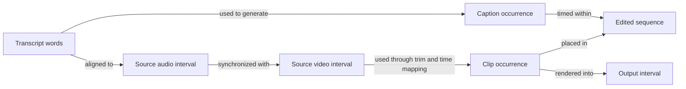
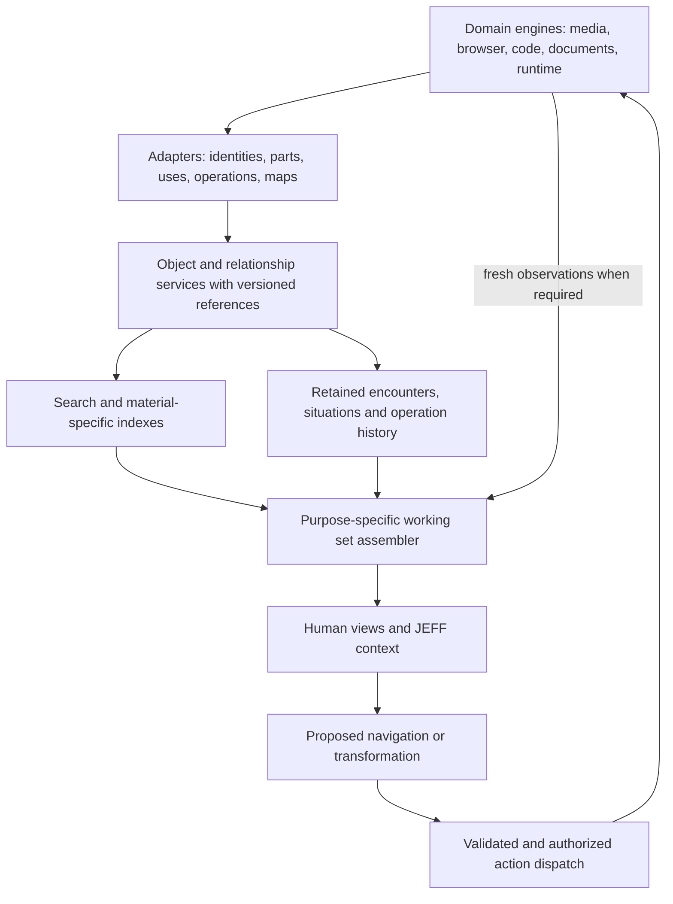

# Memory for a whole operating system of objects

Reframed proposal · 31 August 2026 · First-principles design, not a literature review

The earlier proposal treated experimentation as the central shape of memory. That is one useful neighborhood in Agora, but it cannot explain the whole operating system. A video editor needs to recognize a moment inside a recording. A browser needs to recover an exploration that never became a project. A programmer needs to connect something visible on screen to the running instance and source responsible for it. A person listening to music may want no task or productivity structure at all.

**The broader proposal: Agora's graph should preserve continuity between the things a person encounters, the parts they mean, the ways they use them, the forms they take, and the situations in which they matter. Memory is the ability to reconstruct a useful part of that world when needed.**

This document reasons from hypothetical situations. It does not claim these capabilities exist or that the scenarios actually happened. No further web research was used for this revision. It proposes extensions through facets, references, relationships, adapters, and projections without changing the entity core in [[Agora Objects (superseded)|Agora Objects]].

## 1. Start with an ordinary day, not a research project

Imagine the following independent requests:

| What the person says | What they are actually referring to | What remembering must recover |
| --- | --- | --- |
| “Use the pause before she laughs, but from the other camera.” | A meaningful moment in an event, represented by different recordings | Source intervals, a cross-camera correspondence, and the intended placement |
| “The blue diagram from the page I opened while fixing the sound.” | A visual region in a visited page, cued by another activity | The encounter, page revision, region, and relation to that work situation |
| “Why does this button jump when the export starts?” | A UI instance during a runtime transition | Component/source bindings where available, live state, layout observations and relevant code |
| “Put this part back the way it was before I shortened the music.” | A composition region before a particular edit | Edit dependencies and the old arrangement, not a wholesale desktop rollback |
| “Play the thing we listened to on the train.” | Music encountered in a remembered setting | An entitled listening encounter and plausible recordings, not an invented preference |
| “Can I unplug this drive?” | A physical resource participating in current computation | Open file handles, pending writes, render dependencies and freshness of observations |
| “Give Sam the clip, not my whole edit.” | One scoped use or exported derivative | Its source boundaries, permitted content and a shareable representation |
| “Back to where I was.” | An interrupted situation | Selection, viewport, unfinished local intent, objects and still-valid sessions |

These are not all fact-retrieval questions. They ask the system to locate, disambiguate, transform, resume, inspect, or act. A correct answer often includes opening the right thing at the right place. An eloquent paragraph with no usable reference is insufficient.

The common structure is not “idea, experiment, result.” It is **a person dealing with some part of something, through some representation, in some situation**. The graph needs enough of that structure to maintain continuity across tools and time.

## 2. Files are too large; pixels are too small

The object system needs a way to address meaningful interiors without turning every byte into an entity.

A video is a file to storage, a sequence of frames to a decoder, several shots to an editor, a conversation to transcription, and a particular person's expression to someone looking for a reaction. None of those descriptions should erase the others. Similarly, a repository contains files, but a useful target might be a function, a test case, a DOM element, a runtime stack frame, or a visible defect.

Introduce a general **reference to a part**:

`object identity + content revision + domain-specific selector`

Selectors remain native to their material: time range, frame range, audio channels, text range, table cells, image region, scene element, code symbol, or structured path. A reference can also declare how it should resolve: remain pinned to that version, follow a stable component if possible, or request the current version. “Follow” must report ambiguous or broken reattachment; it is not a promise that semantic identity survives arbitrary edits.

Do not initially mint an entity for every word, frame, AST node, and pixel. Keep most details in the media/editor indexes that understand them. Give a part independent identity when it acquires its own use, annotations, permissions, repeated references, or lifecycle. An identified shot used in three edits deserves that treatment. Every frame in an unused recording probably does not.

This gives Agora three levels of detail:

1. A durable object that other tools can name.
2. Addressable parts provided by an adapter or facet contract.
3. Materialized part objects when those parts become independently meaningful.

The threshold is interaction and usefulness, not an obligation to catalog everything. Search can find an unmaterialized part and return a reference; the person's next action can make it durable.

## 3. A thing and a use of that thing are different

Suppose the same eight seconds of footage appears twice in an edit: first as a quiet introduction, later as a fast callback. The uses have different trim, placement, speed, crop, sound, and narrative purpose. They share a source but must be independently editable.

The graph needs a **use or occurrence**, not merely an edge from “video” to “project.” Its concrete state belongs somewhere:

```text
camera recording @ revision 1
  └─ source interval 00:12:04.200–00:12:12.200
       ├─ use A in sequence 7
       │    placement: 00:00:03.000; rate: 1.0; crop: wide
       │    role in this sequence: introduction
       └─ use B in sequence 7
            placement: 00:01:21.000; rate: 1.5; crop: close
            role in this sequence: callback
```

Times here are illustrative. Real selectors must specify the appropriate timebase and account for variable frame rates and transformations.

“Make this warmer” while selecting use B should not alter use A or overwrite the source recording. “Replace this shot everywhere” is a different command with a wider target set. The graph makes that distinction representable; selection and action policy decide which operation is intended.

The same pattern appears elsewhere:

| Source or definition | Particular use | Why the distinction matters |
| --- | --- | --- |
| A webpage | A tab visiting it, or a captured passage in a note | Closing the tab does not delete the source; the old passage may differ from today's page |
| A function definition | A call site or runtime invocation | One invocation can fail while other uses work |
| A photo | A crop in a slide or an attachment in a message | Local presentation changes should not mutate the original |
| A track | A playlist occurrence or a music bed in a video | Listening order and edited duration belong to the use |
| A dataset | A chart with a filter and aggregation | The chart's visible points are not the entire dataset |
| A reusable component | An instance in a page or scene | Instance overrides and definition updates have different effects |

A use need not always be a new heavyweight entity. Native applications may keep instances in their own structured state and expose references. Promote them when independent reference or policy requires it. The semantic distinction must exist even if the storage layout varies.

This also changes what “same object” means. A proxy video, transcript, rendered frame, exported clip, and source recording might belong to one source family. They are not interchangeable identities. Shared subject, shared bytes, derived content, and equivalent use are different relations.

## 4. Correspondence is the connection that makes multiple media usable

An operating system must connect forms of a thing, not just things with similar descriptions.

Consider one spoken sentence. It can be found as words in a transcript, heard in audio, seen in a shot, displayed as subtitles, and included at a different time in a final edit. Selecting the words should be able to reveal the corresponding sound and picture. Selecting the subtitle should identify its source and its placement in the output.



A correspondence can carry an actual mapping, rather than just a predicate:

- A source-to-output time transform, possibly piecewise after cuts and speed changes.
- A coordinate transform between an image region and a crop.
- Alignment between transcript tokens and audio intervals.
- A mapping from a code symbol to an instrumented UI component.
- A derivation from dataset rows to an aggregate chart mark.

These mappings have different reliability. A renderer may emit an exact provenance map for its output. A transcription alignment is estimated. A model connecting a screenshot to code may only offer candidates. Some mappings are many-to-one or lossy. “This chart came from these rows” does not imply the chart can be edited backward into a unique set of rows.

**The system should preserve exact correspondences when tools already know them and explicitly mark estimated correspondences when they are inferred.** Losing a known map and then paying a model to guess it later is an avoidable architectural failure.

This is a major role for native Agora tools: make their meaningful selections and transformation maps available to the world. Opaque applications can participate at a lower level without pretending to expose their interiors.

## 5. One object does not have one meaning

A recording can be evidence of an event, raw material for a film, a reference for color grading, and a reminder of a trip. A webpage can be something the person believes, something they are criticizing, or merely something they glanced at. Opening the page establishes none of those interpretations by itself.

Store **roles in context** rather than stuffing all meaning into one summary facet:

```text
this source interval
  used in: sequence 7
  role here: quiet introduction
  selected by: Alex
  selection rationale: leave space before the interview begins

the same interval
  used in: editing lesson 3
  role here: example of an overexposed background
```

Neither role is a global property of the footage. Neither says the recording is intrinsically quiet or bad. The participant, purpose, and particular use qualify the relation.

The corresponding programming example is a workaround that is appropriate in a disposable script but unacceptable in a reusable library. A personal example is music suitable for a party but unwelcome during concentration. Global “user likes X” facts erase those distinctions.

JEFF should learn conditional familiarity: “Alex used this pacing in these two travel edits,” or “this tool worked for this format under these conditions.” It may propose a broader preference, but should not silently turn sparse behavior into a permanent model of the person.

Negative connections are useful too: not this take, not that person with the same name, don't suggest this track for this edit, this page was rejected as a source. Preserve their scope. “Not for this use” must not become “never show this again.”

## 6. Situations connect activities without forcing everything into a project

A project is often too large for current attention. A session is often too arbitrary: it ends when an application closes, not necessarily when a piece of work makes sense. And much computer use has no named project.

Introduce a **situation** as an optional, revisable account of what is being dealt with together. For example: “finding a better opening shot,” “getting the microphone working,” “reading about a place we might visit,” or “listening with Sam.” It can begin with the user's explicit focus and acquire participants, objects, questions, selections, and activities as work proceeds.

A situation records just enough for continuity:

- Focal objects and selected parts.
- What the person was trying to do, if stated or tentatively inferred.
- Roles of nearby material: candidate, reference, background audio, output, unresolved question.
- Useful return positions: timeline playhead, source range, code symbol, page region.
- Active jobs and resource bindings, with freshness and availability.
- Open continuations: the next comparison, an unfinished selection, an unsent draft.

It may be unnamed, overlap another situation, or belong to several projects. A temporary task can sit within a larger situation, and several activities can serve one situation. The graph records these relations rather than imposing a universal nesting tree.

Inferred grouping is fallible. Switching to a browser might be research for the edit or an unrelated break. JEFF should keep a provisional association and allow correction; it should not merge all simultaneous activity into one intention. Silence is also allowed: no meaningful grouping need be retained.

This is what makes an apparently vague cue useful. “The blue diagram while I was fixing the sound” combines a visual characteristic with an encounter context. No single document embedding necessarily captures that route. The situation bridges the remembered experience to the target part.

## 7. The graph needs several kinds of connection, with different behavior

Do not let a generic `related_to` relation carry the entire system. Also do not create a universal taxonomy of every human activity. Keep a small set of structural connection families and let domain semantics grow within them.

| Connection family | Example | What it enables | What it must not imply |
| --- | --- | --- | --- |
| Structure | Sequence contains clip occurrence; document contains anchored passage | Navigation and selection | Same ownership or permissions |
| Identity and reference | Tab refers to resource; symbol reference resolves to definition | Find the intended subject | Matching names prove identity |
| Correspondence | Transcript words align to audio; frame maps to output | Move between representations | Every mapping is exact or reversible |
| Derivation | Export was generated from sequence revision and assets | Reproduce, explain and invalidate | Derivative remains live-linked forever |
| Use and role | This clip supplies background footage here | Local edits and relevance | Global properties or preferences |
| Activity and resources | Renderer reads drive and writes output | Operational awareness and safe action | Old observations describe current state |
| Encounter and situation | Page inspected while diagnosing sound | Recall by circumstance and resume | Co-occurrence establishes causation |
| Meaning | Diagram explains mechanism; image resembles a reference | Search and analogy | Similarity proves substitutability |
| Expectation and constraint | Output needs captions; procedure requires a format | Detect unfinished or incompatible work | Inferred intent authorizes execution |
| Social relation | Person commented on this range in a shared room | Attribution and collaboration | Relationship permits disclosure |

Different families require different maintenance. A source-version derivation can be permanent while its payload is retained. A process/file-handle relation expires quickly. A provisional analogy can disappear when unused. A contextual rejection persists only as long as its scope remains meaningful and retention permits it.

There should be many query-specific views of a connected substrate. The semantic graph, scene graph, computation dependencies, social relationships, and attention state are not one homogeneous topology. Shared references let the system move between them when useful. Their rules remain distinct.

## 8. Verbs create richer connections than noun extraction

“Paste,” “trim,” “compare,” “quote,” “render,” “run,” “open,” “attach,” and “replace” already know something about their inputs, targets, and outcomes. These operations are the most reliable opportunity to connect the world.

For example, pasting a passage into a script can preserve the source anchor, destination range, and transformation. Pasting as a quotation, adapting an explanation, and copying an example are different uses; the operation can record what it knows and leave purpose unresolved. Exporting can preserve source revisions, filters, chosen ranges and output mappings without reading a conversation transcript.

An **operation record** can bind several participants with roles:

```text
operation: place clip into sequence
actor: authenticated user session
input: source interval, pinned revision
target: sequence and insertion position, expected revision
parameters: trim, rate, audio handling
output: a new clip occurrence
mapping: source time ↔ occurrence time
situation: opening-shot selection, if established
outcome: committed / failed / partial
```

This is naturally richer than a binary edge. Store an operation/event plus participant roles, then derive convenient traversal edges. Do not invent a pairwise relation between every participant. Sharing an operation does not make all inputs semantically equivalent or mutually dependent.

Record performed operations separately from candidate operations. Seeing how a piece of footage could fit into an edit is useful; claiming it has already been used is false.

Adapters should expose the richest supported level: resource identity, meaningful selections, committed operations, representations, mappings, and observations. Native integration can expose more. A wrapped application may expose only a file and a window. It should label that boundary instead of inventing internal state.

Simple mechanical connections should not require a model call. Models help where interpretation matters: finding a reaction shot, identifying a conceptual analogy, proposing a situation, or explaining why a connection is useful. This division is a design choice to preserve responsiveness and avoid unnecessary inference.

## 9. Memory has to return something the person can work with

The earlier evidence-packet proposal remains useful for explanations. It is too narrow as the universal return type for OS memory.

Different requests should yield different results:

| Request | Useful result |
| --- | --- |
| Find | A resolved object or part, with a suitable preview and an open-at-location action |
| Remember | A small set of candidates with encounter cues and uncertainty |
| Resume | A restorable working set with current availability and pending continuations |
| Explain | Source evidence, relationship paths, relevant versions and caveats |
| Compare | Aligned views of selected alternatives, preserving their identity and differences |
| Use or transform | A bounded candidate operation with concrete inputs, mappings, prerequisites and effects |
| Inspect live state | Fresh observations and identified gaps, not a historical summary |

If the user asks for “the moment she looks away,” returning the recording title is an incomplete retrieval. The result should open a short range near the candidate moment. If uncertain, present two short previews instead of a confident invented timestamp.

If the user asks to resume coding, returning a project summary is insufficient. The useful result includes the correct worktree or source revision, relevant symbol, unsaved-buffer availability, test state, and live service identity. Restore view state separately from changing content or restarting processes. Do not imply that the exact old session can be reconstructed when the adapter never captured it.

If the user returns to browsing, restore the question and relevant encounters rather than dumping every old tab. A closed comparison can stay closed; a source kept as background need not reopen. Reinstatement should serve the person's current request, not blindly reenact the past.

### A temporary working set, not the whole graph in context

JEFF's immediate context should be a temporary, purpose-specific view assembled from:

1. The selected object or part, current situation, and explicit request.
2. Relevant structure, uses, correspondences and live dependencies.
3. A few applicable encounters, preferences or procedures.
4. Only the source detail necessary for the next step.

Different questions expand different relations. “Where did this come from?” follows provenance. “Can I unplug this?” follows current resource use. “Find something with this mood” uses perceptual and semantic cues. “What else uses this?” follows occurrences and composition dependencies. One distance metric over all edges cannot express these different intentions adequately.

The working set is allowed to change while a situation continues. If attention moves from pacing to sound, the same clip remains central but waveform, music bed, dialogue level and audio tools become relevant. The color-grading reference can recede without being forgotten.

This is a form of memory **activation**, separate from persistence. Something can be remembered for years without being included in today's context. Something can be visually salient for five seconds without deserving permanent storage.

## 10. Projection must depend on purpose and material

The current `facet.project(budget)` concept describes level of detail. An OS needs a second dimension: which view of the object is useful for this purpose?

For the same clip:

- Editing rhythm calls for duration, cuts, motion and neighboring placements.
- Dialogue work calls for transcript, speaker turns and audio intervals.
- Color work calls for representative frames and relevant transform state.
- Reusing it calls for source availability, current use constraints and output requirements.
- Remembering it calls for encounter cues and recognizable preview moments.

Propose a richer projection request, composed by trusted software:

`project(reference, purpose, viewer, situation, revision, available modalities, budget)`

This is an API-level proposal, not a new mandatory core field. A generic fallback can return identity, available facets, provenance and an open action. Richer adapters may supply better views.

The budget is not only tokens. Images, audio duration, video frames, decoding cost and latency consume resources too. For a model that cannot inspect video directly, the projection may supply selected frames, transcript spans and references that can be expanded. For a person, it may supply a scrub-capable preview. Neither should flatten all material into prose and discard its structure.

Do not make a separate unconditional summary the sole representation of every object. It will emphasize the wrong properties for many tasks. Keep inexpensive reusable descriptors, but assemble the final view according to purpose and available modalities. Preserve enough identity and mappings that every preview can lead back to the thing it depicts.

Native editing remains in its real-time engine. A video timeline, audio playback, cursor movement, and compositor should not wait for graph inference or an LLM to approve routine updates. Their adapters emit bounded state changes and meaningful committed operations; the memory layer catches up. Safety-critical actions that depend on fresh resource state must request it directly rather than trust a lagging memory index.

## 11. Useful memory includes possible actions, but possibility is not history

Once objects expose their material and installed tools expose validated capabilities, Agora can ask a different kind of question: **what could connect these things?**

A selected article passage and a video sequence have no useful direct edit operation. But the passage could become a script excerpt, then recorded narration, then a timed occurrence in the sequence. A code-generated animation could be rendered into a clip. A table could generate a chart that appears in a report and a video. A photograph might be usable as a still image, a cropped detail, or a reference for a scene's color.

These are possible transformation paths. They should be generated on demand from actual handler contracts, allowed resources, and the person's goal. Do not permanently add an edge between every pair of objects that could conceivably be connected.

The distinction is:

```text
historical connection:
  this chart was rendered from these dataset rows at revision 8

possible connection:
  this installed chart handler could turn this table into an image
  that the current video editor could place in the selected sequence
```

A candidate path must state requirements and losses: media format, units, timing, quality, missing assets, current tool availability, cost and destination. It may be impossible. It may require user judgment. A matching input/output type is necessary for many operations but does not prove that the result makes sense.

JEFF can use previous successful operations as examples, while validating current capabilities and preconditions anew. “We did this before” helps plan; it is not authorization or a guarantee it will still work.

This allows creative association to be actionable. Rather than “these are related,” JEFF can propose: “This simulation could illustrate the paragraph you selected; I can prepare a short preview using the current parameters.” The graph identifies the inputs and candidate route. The creative assessment remains a proposal that the person can reject.

Some valuable connections will not be topical at all. An animation's acceleration and a musical phrase may share a rise, pause and release. An arrangement of photos may supply a visual ordering that works for a set of code examples. A successful explanation may suggest a reveal order for an interface. The relevant relation is rhythm, arrangement or rhetorical structure, not “mentions the same concept.”

Keep multiple descriptions of material and ask which aspect matters for the present intention. A single universal similarity score would flatten these different possibilities. JEFF can propose an analogy, identify the aspect it would transfer, and produce a bounded preview. It should not persist every weak resemblance as a fact or assume that an aesthetically promising connection is mechanically valid.

## 12. A video-editing walkthrough

Imagine a short film with two cameras, separate audio, a soundtrack, captions, a script, graphics, and several exports. The useful graph includes:

- The recorded event, with recordings that may be synchronized to it.
- Media assets and retained revisions.
- Addressable intervals, detected shots, transcript spans and audio channels.
- Clip and sound occurrences in compositions.
- Transform parameters and source/output mappings.
- Comments attached to particular versions and ranges.
- Render activities, inputs, output artifacts, live dependencies and availability.

The user says: “Take the hesitation before Maya laughs, from the second camera, and put it where the opening feels too rushed.”

Reason through this without pretending the graph knows everything:

1. The selected sequence and recent work identify a likely opening region. If no region is grounded, the command has an unresolved target.
2. Transcript and audiovisual cues provide candidate moments for hesitation and laughter. They are perceptual judgments, not exact textual matches.
3. A verified or estimated synchronization map connects the event interval to camera two. If the map is missing, aligning the recordings is a separate task.
4. The editor proposes an occurrence with source interval, insertion point and timing. The original recording remains unchanged.
5. The prospective edit checks adjacent audio, transitions and caption placement. It can preview rather than commit an ambiguous timing change.
6. On commit, the operation records the occurrence and mappings. “Less rushed” stays a scoped rationale for this edit, not a universal property of the source.

Later, the user asks: “What changes if I remove that pause?” The system can distinguish direct mechanical effects from aesthetic guesses. Affected clip timing and mapped caption occurrences may be computable. Whether the scene feels worse is a judgment for a preview, not a graph theorem.

If a source file goes offline, the graph can still identify what is missing, which cached proxies are available, and which exports or future renders depend on it. “Remembering the clip” and “having the full-resolution bytes available” are different states.

This workflow requires memory of parts, uses, correspondence, material, aesthetics, sequence time and current resources. A graph of experimental decisions alone misses almost all of it.

## 13. A browsing walkthrough

Imagine wandering through several pages while trying to understand why an audio workflow behaves strangely. There is no declared research project and no final report.

Distinguish a web resource from each encounter with it. A resource has a URL and perhaps a stable provider identity; an encounter has a time, navigation path, observed revision if captured, selected or visible regions, and a possible situation. Tabs are live viewing instances. Saved excerpts are uses of source material. A query result is a lead, not evidence that the page was read or its claims accepted.

The user later says: “Find the blue diagram from when I was fixing the sound.”

The system can combine an approximate situation, remembered visual appearance, page encounters, and image-region descriptors. It should return a few identifiable previews with their source pages. It need not first convert the experience into a permanent proposition about audio engineering.

If the page was not captured, the system may only know where it was and what small authorized descriptors were retained. Reopening may reveal changed or missing content. Report that honestly. Do not claim a screenshot, precise scroll position or complete browsing trail exists unless it was actually captured under the retention policy.

A more subtle request is: “There was another explanation I understood better.” Here the memory may use comparisons, time spent only if appropriately retained, explicit reactions, annotations and a remembered return to the page. It should not infer comprehension from dwell time alone. The strongest evidence would be an explicit “that makes sense” connected to a particular passage.

This leads to a different web-memory primitive: an **encounter with addressable material**, optionally situated, rather than a bag of facts extracted from everything visited. Save knowledge when useful, but also preserve selected routes back to the experience itself.

## 14. A code and runtime walkthrough

Imagine a person editing code while looking at a running preview. They point to a control: “This jumps when the export starts.”

The target is not just a repository or a file. It is a UI instance in a specific runtime state. A richly integrated system could follow:

```text
selected UI instance
  → bound component or element
  → relevant source symbol and working revision
  → style/layout inputs
  → observed state transition during export
  → runtime and resource activity
```

Each arrow must be backed by an available adapter, mapping or observation. Without instrumentation, some arrows are hypotheses. A symbol's source span can be known exactly while its connection to the visual movement remains uncertain.

The useful response might show the before/after layout, the relevant component, and a candidate cause. If a similar defect was fixed elsewhere, the system can retrieve the old pattern and explain what conditions match. A lexical resemblance between two functions alone is weak evidence of a transferable fix.

The graph should distinguish source definition, worktree version, built artifact, running incarnation, call site and observed invocation. Changing a source file does not mean the running process has incorporated that change. Passing an earlier test does not verify the present version. Opening a cached preview does not show the current build by definition.

After the person leaves and returns, memory can reestablish the relevant code range and investigation state. It should also ask the runtime service for current observations. The old task context persists; the old PID and old “tests pass” state do not automatically remain applicable.

Coding memory therefore combines structure, runtime correspondence, state freshness, working views and prior experience. Experiments and decisions fit inside it, but they are not its entire substance.

## 15. The operating system's own condition belongs in the model

Applications and content are not the whole world. Devices, volumes, processes, jobs, endpoints, permissions, outputs and resource pressure affect what the person can do.

“Why is this slow?” may require the current render queue and memory pressure, not a remembered performance discussion. “Can I unplug this drive?” requires knowing which activities still depend on it and whether writes are safely complete. “Where is the export?” asks about an activity and its output, which may be pending, failed, partial, local, or remote.

Model a stable logical service separately from its runtime incarnation. Connect activities to their input revisions, output destinations and observed resource bindings. These relations need timestamps, freshness limits, and refresh mechanisms. They are not long-term beliefs to be retrieved indiscriminately.

A dependency edge can guide investigation, but cannot by itself authorize a claim of safety. For example, absence of an indexed reader is not proof that a drive has no open handles. The final action must use the resource manager's current check. The graph supplies the explanatory and navigational context around that operation.

The result is continuity between the visible world and the machine running it: an output card can lead to its render activity, source sequence, missing asset, and current resource problem. Those links should be inspectable by the person as well as JEFF.

## 16. Change should travel through the right connections

A dense graph can easily make every change look like it affects everything. That would produce stale-state warnings, recomputation and interruptions constantly.

Distinguish these cases:

| Relation to a changing source | Appropriate default |
| --- | --- |
| Live declared dependency | Recompute or mark stale according to its contract |
| Pinned use of a retained revision | Stay on the chosen revision; offer an explicit update if useful |
| Historical derivation | Preserve history; do not rewrite old exports |
| Citation or quotation | Preserve the captured version; possibly flag a newer source |
| Approximate semantic association | Reassess only if relevant; no automatic content change |
| Shared subject without data dependency | No automatic invalidation |

A color adjustment may invalidate a video preview without invalidating a transcript. A trim may change caption placement without changing the words spoken. A code comment change may affect explanation search without requiring a new rendering of a static graphic. The adapter should declare dependencies at a useful granularity where possible.

This requires connection semantics that distinguish “related,” “reads,” “derived from,” “pinned to,” and “follows latest.” It also requires genuine versioned inputs. It cannot be solved by one generic graph-neighbor notification.

The domain engine owns its actual edit and recomputation semantics. Agora owns cross-object dependency visibility and dispatch to the appropriate engine. The memory layer should not reinvent every application's execution model.

## 17. Time is not one axis

The system must distinguish several coordinates:

- When a person encountered or did something.
- Which content revision or world branch was involved.
- The position within material: video time, audio samples, a sequence location, or a document anchor.
- When a runtime observation was collected and whether it remains fresh.
- When an interpreted claim applies, and when it was learned.

“The shot before the interview” refers to composition order. “The shot we used before lunch” refers to activity history. “The shot before the last edit” refers to a revision. They can name three different targets.

Store these dimensions where they belong and let adapters translate between them. Do not turn all of them into one timestamp field. Relationships crossing timelines or revisions need explicit mappings and uncertainty.

Rollback remains important, but it is one special case of historical continuity. Ordinary undo, media edits, file replacements, application restarts and interrupted work create similar demands without a VM rollback ever occurring.

## 18. What to keep, what to compute, and what to forget

An OS may encounter more material than it is useful or appropriate to remember. The graph should grow selectively.

| Keep durably when permitted | Keep briefly or locally | Compute when asked |
| --- | --- | --- |
| Object identities and retained source/version references | Fine-grained cursor and playhead motion | Distant semantic associations |
| Meaningful committed transformations and their known mappings | Rapidly changing runtime observations | Candidate transformation plans |
| Explicitly saved parts, comments and scoped preferences | Provisional situation membership | Expensive multimodal interpretations |
| Uses that affect actual compositions or outputs | Candidate detections never used | Detailed context-dependent projections |
| Useful return points and chosen continuations | Background browsing context under a short policy | Cross-project analogies |

This is a starting policy, not a fixed rule for every medium. A person may explicitly preserve a browsing session or a precise performance trace. They may also choose not to retain an encounter at all. Meaningful durable capture should be cheap enough to use routinely; rich interpretation can be deferred until material becomes relevant.

Private encounters, source descriptors, relationships and derived summaries can themselves reveal sensitive information. Authorization applies before combining them or sending them to a model. A graph crossing a boundary is not consent to cross that boundary. Sources and derivatives must remain correctable and erasable under the chosen policy.

Memory should survive interruption without becoming an exhaustive recording of the person's behavior. The useful question is “what must we preserve to help them return or act?” rather than “what can we collect?”

## 19. What the architecture should look like

The core should be a connective layer over specialized object systems, not one database expected to understand every domain's interior.



There are four architectural responsibilities:

1. **Identity and addressing:** stable references, versions, parts, occurrences, availability and policy boundaries.
2. **Connection capture:** domain-declared structure, operation participants, correspondence maps, encounters and carefully attributed interpretations.
3. **Activation and presentation:** choose a purpose-specific neighborhood and render it as previews, aligned views, context or a resumable working set.
4. **Action and feedback:** use real capabilities, preserve edit scope, record outcomes, and learn from explicit correction without confusing it with global truth.

A minimal adapter can expose an object and a way to open it. A better one can expose meaningful parts. A richer one can report changes, uses and mappings. Tools should be able to participate incrementally, with explicit descriptions of what cannot be inspected or restored. Agora-native contracts should make richer participation easier without requiring every third-party application to convert at once.

The persistent store can use entities and facets already proposed for Agora. Parts may be compact references; occurrences and situations can be entities when independent identity is useful; operations belong in event/history records; correspondence maps can be versioned facets or linked mapping objects. Semantic assertions retain their own provenance. These are roles in a protocol, not a new hierarchy of object classes.

Domain indexes can remain specialized: media segmentation, text search, code symbols, live resource observations. The shared layer resolves their results into common object references. Search should be able to return material that was never globally promoted into a graph node.

Installing a new authorized tool can make old objects useful in new ways. A transcription adapter may expose addressable speech in recordings that previously had only filenames. A chart renderer may offer new uses for existing tables. Record the new representation and its lineage without changing what the original object was. Build expensive interpretations lazily or under an explicit background budget; installing a tool should not automatically scan and disclose the person's whole history.

No component has to interpret everything. The important requirement is that the components can identify where their own knowledge begins and ends, and give the rest of Agora usable references across that boundary.

## 20. A first prototype that actually tests the OS idea

The initial prototype should span different materials and several forms of continuity. A project-history benchmark alone cannot validate this design.

Use a small local corpus with an article capture containing a diagram, a short recording with a transcript, a small code-generated animation, an editable sequence manifest, and a simple render activity. These are proposed fixture materials, not files created or media processed in this revision. Full professional editing software is unnecessary for the experiment; the fixture still needs real selections, instances and mapping semantics.

Walk through these operations:

1. Select a passage and diagram from the article; retain exact part references.
2. Use that material as a reference while changing the animation's code; record the role without claiming the code mechanically derives from the paragraph.
3. Render an animation artifact from a pinned source revision and parameters; capture the actual computational dependency.
4. Place the artifact and two different uses of one source clip into a sequence.
5. Select transcript words and navigate to the corresponding source and sequence intervals.
6. Change one occurrence's trim; show the other occurrence is unchanged.
7. Change the animation's code; distinguish old pinned renders from live outputs that need rebuilding.
8. Interrupt, restart a runtime, and resume the correct selection and work situation while refreshing live state.
9. Retrieve the diagram by an encounter cue rather than its filename.
10. Prepare a shareable clip without including private comments or unrelated source history.

Then test independent situations that do not fit this production workflow: casual page rediscovery, a listening encounter, and a live resource question. The point is to avoid proving a universal model only against one carefully selected cross-media project.

Measure successful reference resolution, correct edit scope, correspondence quality, context restoration, current-state accuracy and useful navigation. Also measure how much annotation the person had to do, how often inferred associations were wrong, and how much extra work the memory layer introduced. The model is weak if it works only after someone manually curates the graph.

The earlier security and provenance tests remain necessary. They are supporting constraints, not the primary evidence that the operating-system memory idea is useful.

## 21. The changes to the original proposal

| Earlier emphasis | Broader design |
| --- | --- |
| Memory of decisions and experiments | Memory of interaction with materials, representations, uses and live systems |
| Mostly whole-object entities | Objects plus addressable parts and independent occurrences |
| Semantic and provenance edges | Structure, correspondence, use, computation, encounter and meaning with different rules |
| Project as organizing context | Overlapping, optional situations; projects are one larger grouping |
| Textual evidence packet | Located previews, aligned representations, returnable working sets, evidence and candidate actions |
| Generic budgeted summary | Purpose- and modality-dependent projection |
| Search followed by graph traversal | Choose relations according to whether the user is finding, resuming, editing, comparing or inspecting |
| Learn from completed work | Also preserve selected encounters, material familiarity and unresolved continuations |
| First test: explain why an approach failed | First test: maintain identity, scope and context while moving among browsing, code and media |

The hard research question becomes: **can Agora preserve the person's referent and intention as work moves between representations, tools, situations and time—without requiring constant annotation or pretending to know more than it does?**

That is the OS-wide memory capability worth building. Decision history is one of its uses.
