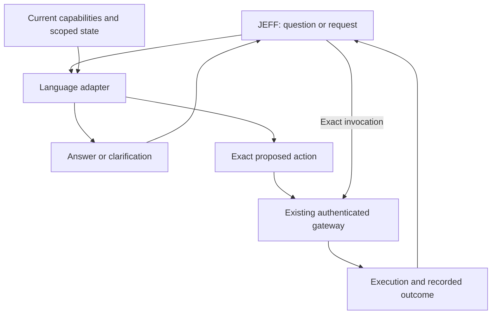

# Conversational interfaces to Agora capabilities

Research proposal · 15 September 2026

> **Status:** Exploratory design and literature review, prompted by Alex's proposal that JEFF could ask Agora questions and request actions in natural language through a small, specialized language adapter. This document records a direction worth investigating, its limitations, and an experiment to evaluate it. It establishes no new implementation requirement or settled architecture. No adapter was implemented, trained, benchmarked, or activated for this research.

## 1. Research question and initial assessment

Could Agora become easier for JEFF to inhabit by allowing it to converse with the environment about its capabilities?

Alex's motivating example is simple. JEFF asks what actions the notes application exposes. A thin language adapter describes sorting, filtering, creation, deletion, and other operations that actually exist. JEFF then says something like “sort the notes by size,” and the adapter translates that request into an action processed by the ordinary system.

The proposal has two separable parts:

1. **Conversational discovery:** explain available capabilities, answer focused questions, and help JEFF identify relevant operations.
2. **Language-to-action translation:** resolve a natural-language request into an exact executable operation and arguments.

Both are technically plausible. Related systems already translate language into executable representations, specialize small models in function calling, and separate planning from action production. What remains unproven is whether inserting a second model improves JEFF's performance in Agora.

**Initial assessment:** conversational discovery is the strongest first experiment. Bounded request translation is also worth testing, while retaining exact invocation as an equally available route. The larger opportunity is an environment that communicates what is possible, what a request would mean, and what actually happened.

## 2. Existing substrate and evidence boundary

The newer implementation inspected for this proposal is `C:\Projects\Agora4`, whose Python package remains named `agora3`. It is distinct from the older prototype in this repository's `kernel/` and `jeff/` directories. Older prototype contracts must not be assumed to describe the newer implementation.

The inspected Agora4 source defines two world-facing model tools:

- `agora_discover {}` reads the current gateway action registry.
- `agora_invoke {name, arguments}` invokes an operation through authenticated dispatch.

The runtime guide documents `tools.list` for installed package actions, including package and installation revisions. Installed actions exist independently of whether their visual interface is open. Package manifests provide action descriptions, input schemas, optional output schemas, and optional read declarations. Package invocation checks the selected installation revision and validates arguments.

Source references:

- [JEFF tool definitions and dispatch](C:/Projects/Agora4/src/agora3/jeff.py).
- [Gateway discovery and validation](C:/Projects/Agora4/src/agora3/gateway.py).
- [Package manifest validation and invocation](C:/Projects/Agora4/src/agora3/packages.py).
- [Agora4 Runtime Guide](<C:/Projects/Agora4/docs/Reference/Runtime Guide.md>).

The relevant files were clean relative to Agora4 commit `c889ef724ac0f53eeadd8cf644b946303ba21a49` when this document was written. These are local source references, not evidence of the revision loaded by a running service. No live runtime or model inventory was tested for this proposal.

The existing structure is a useful foundation. Natural language can become another client interface to the same operations. Native-world changes must continue through authenticated dispatch and the existing event path; replay must never invoke the translator or repeat an external effect.

Two top-level tools do not necessarily imply a small cognitive burden. JEFF must still discover the relevant operation, understand its semantics, resolve objects, assemble arguments, and interpret the outcome. The proposed adapter would take responsibility for selected parts of that work.

## 3. Research precedents

The sources below support individual ingredients. Their evaluations do not establish performance in Agora, and the precise combination proposed here should be treated as a hypothesis.

| Work | Relevant contribution | Limit of the comparison |
|---|---|---|
| **Genie / ThingTalk** | Genie trains semantic parsers to translate natural-language commands into an executable assistant language. ThingTalk represents requests and dialogue context formally and supports composition across independently developed functionality. | Task-oriented parsing establishes a useful architecture, not reliable interpretation of every request in an evolving object environment. |
| **Gorilla** | Specializes a model in generating API calls and uses retrieved documentation to accommodate API changes. | Its APIBench setting differs from stateful interactions with authored applications and shared objects. |
| **Octo-planner** | Separates a planning model from an action model responsible for function execution. This closely resembles JEFF communicating steps to a smaller translator. | Reported in-domain results do not establish generalization to new Agora applications or improvement over JEFF invoking actions directly. |
| **FunctionGemma** | A 270-million-parameter model specialized for function calling and local deployment makes a very small translator technically credible. | It is designed for customization; small size alone does not establish adequate reliability or dialogue understanding. |
| **SayCan** | Grounds proposed language actions in skills available in an environment. | Robotic feasibility and software validity differ. The transferable principle is to ground suggestions in real capabilities and current conditions. |

Primary sources:

1. Campagna et al., **Genie: A Generator of Natural Language Semantic Parsers for Virtual Assistant Commands** (2019). [Paper](https://arxiv.org/abs/1904.09020).
2. Lam et al., **ThingTalk: An Extensible, Executable Representation Language for Task-Oriented Dialogues** (2022). [Paper](https://arxiv.org/abs/2203.12751).
3. Patil et al., **Gorilla: Large Language Model Connected with Massive APIs** (2023). [Paper](https://arxiv.org/abs/2305.15334).
4. Chen et al., **Octo-planner: On-device Language Model for Planner-Action Agents** (initially 2024; revised 2026). [Paper](https://arxiv.org/abs/2406.18082).
5. Google DeepMind, **FunctionGemma**. [Official overview and evaluation](https://deepmind.google/models/gemma/functiongemma/).
6. Ahn et al., **Do As I Can, Not As I Say: Grounding Language in Robotic Affordances** (2022). [Paper](https://arxiv.org/abs/2204.01691).

The especially interesting Agora-specific combination is **language mediation plus runtime authorship**: JEFF creates a capability, installs it, and the environment can immediately explain and expose it through the same conversational interface.

## 4. A worked interaction

The following dialogue assumes hypothetical Notes capabilities. It does not claim that a current application exports these operations.

> **JEFF:** What can I do with the notes in this view?
>
> **Agora:** You can filter by tag, sort by title, modification time, or text length, and create or archive notes. Sorting affects this view. Archiving affects the underlying notes. The current filter includes 23 notes.
>
> **JEFF:** Sort them by size.
>
> **Agora:** The available size measure is text length. Longest first or shortest first?
>
> **JEFF:** Longest first.
>
> **Agora:** Sorted the 23 matching notes by text length, longest first.

Underneath the exchange, the interpretation should remain inspectable:

```text
Target: Notes view n17
Action: set sort order
Key: text length
Direction: descending
Scope: this view
Package revision: 12
```

This is illustrative notation, not a proposed frozen API. The implementation must distinguish a maintained sorting rule over a view from a one-time reordering of a fixed collection. New matching notes may participate automatically in the former. A collection reorder may require an explicit target set and revision checks.

The final sentence must derive from execution evidence. If the operation saves a sort setting but does not verify browser rendering, the result should say that the setting was saved. The interface should not claim visual verification it does not have.

Clarification need not involve the person. JEFF may already know the intended direction from the original request and can answer the adapter. Routine defaults can also be explicit in the action contract, allowing a reversible action to proceed without an unnecessary exchange.

Other useful questions include:

- “Can I do that without changing the shared ordering?”
- “What would this operation affect?”
- “Why is this action unavailable?”
- “Can I group these without moving them?”
- “What changed since I last looked?”

Some answers require only capability descriptions. Others require scoped state inspection, provenance, availability checks, or genuine preview support. A language model cannot supply those missing system capabilities merely by explaining them fluently.

## 5. Proposed division of responsibility



The adapter interprets the request against supplied capabilities and context. It does not become an independent source of authority. Invocation retains the original caller's identity and effective delegation, including cancellation and budgets.

The service should be usable as an environment capability by different clients. Placing the useful knowledge in Agora's discoverable contracts allows a person, JEFF, or another agent to benefit. This also makes it possible to test whether the environment itself has become easier to use.

The number and names of top-level model tools remain open. The experiment does not require discarding the discovery/invocation structure. A conversational operation could itself be exposed through that structure, or an adapter could mediate requests before ordinary dispatch. Either arrangement must avoid hidden authority expansion and account for its internal calls.

### 5.1 Keep model work bounded

| Request | Required responsibility |
|---|---|
| “Sort this view by text length, descending.” | Map an explicit intention to an operation and arguments. |
| “Put the longer ones first.” | Resolve references and synonyms using local context. |
| “Organize these notes so I can finish my paper.” | Understand goals, judge relevance, design a workflow, and evaluate success. |

The first is a credible target for a tiny specialized model. The second is plausible with carefully supplied context. The third calls for much of JEFF's reasoning ability. An adapter that accepts the third category has taken on planning responsibility and needs to be evaluated accordingly.

A bounded input packet could contain the request, target object or view, relevant capability contracts, current revisions, selected references, and a small amount of structured dialogue context. Exact references must survive conversational shorthand such as “those,” “the previous result,” or “do it again.”

One shared model could serve many objects by receiving different packets. An object can appear conversational without having its own resident model or private agent loop.

### 5.2 Use deterministic machinery where it suffices

Enumerating declared actions, listing valid parameter values, validating arguments, and reporting structured outcomes often need no model. Simple requests might be handled by templates or direct mappings. A model is most useful for interpreting varied wording, finding relevant capabilities, and explaining distinctions.

The minimum reliable system may combine retrieval, ordinary code, and a model. Its complexity should be judged by responsibilities and failure modes, not by parameter count alone.

### 5.3 Preserve exact invocation

When JEFF knows the exact operation, natural-language translation may add delay and ambiguity. Exact invocation should remain available for precise or repetitive work. Conversational assistance is particularly useful when JEFF knows the intention but needs help finding or understanding the operation.

## 6. What this could unlock

### 6.1 Applications that teach clients how to use them

An unfamiliar application could answer “What can this collection do that would help me find unfinished work?” with a small set of relevant capabilities, their limitations, and examples. JEFF could request exact schemas when useful.

This could reduce repeated investigation and unrelated documentation in JEFF's context. **Hypothesis:** focused conversational discovery produces much of the benefit before language-based execution is introduced.

### 6.2 Discovery by purpose

An action named `set_grouping` may be relevant to “help me see which projects are stalled,” but connecting the name to the intention takes work. Semantic discovery could retrieve filtering and grouping capabilities and explain what each contributes.

Finding relevant operations is a narrower responsibility than choosing and executing a workflow. A first version can return alternatives and leave the larger plan to JEFF. It must also distinguish “no match found in this search” from “no such capability exists.”

### 6.3 Immediate usability of authored capabilities

JEFF could build an application, describe its actions and effects, exercise its interfaces, and improve the contract when either human or agent use causes confusion. Another session could then use it without reading the implementation.

A central requirement is that newly authored actions become usable through supplied descriptions and schemas. Retraining for each application would impede spontaneous authorship. Training should improve the general ability to interpret contracts; held-out application tests must establish whether that works.

### 6.4 A shared interface for people and agents

A person could speak directly to a selected object: “Show only the notes I changed yesterday.” Different agents could use the same capability descriptions under their own identities and permissions.

The language interface can therefore be another projection of Agora's capabilities alongside controls and exact tool calls. It should not create capabilities or private information that are unavailable through the underlying system.

### 6.5 Inspectable learned expressions

A later extension could allow phrases such as “reading view” to refer to an established filter and ordering. The resolved routine could be stored as an explicit world object with parameters, scope, and revision.

This would make repeated operations predictable and cheap. Ambiguous phrases must not silently become lasting preferences, and subsequent application changes must not silently alter the routine's meaning.

### 6.6 Better evidence of missing capabilities

An honest interface might report: “I can sort by length and modification time. I have no action for grouping by topic.” That exposes a concrete authorship opportunity for JEFF.

Language can help identify and explain a gap. Creating a new action remains a distinct development activity, with its own execution and validation evidence.

## 7. Requirements and failure modes

### 7.1 Semantic ambiguity survives schema validation

“Size” could mean character count, storage bytes, attachment size, or visual dimensions. “Delete” could mean remove from a collection, archive, or erase content. Each interpretation could produce valid arguments.

Schema validation detects malformed input. It does not establish fidelity to intention. The adapter needs outcomes such as **resolved**, **needs clarification**, **unsupported**, and **currently unavailable**, rather than an obligation to produce a call.

Use declared defaults where appropriate and expose consequential assumptions. Confidence reported by the model is not proof of semantic correctness; any confidence-based policy would need calibration against actual failures.

### 7.2 Handoffs can lose meaning

JEFF may already understand the task precisely. Compressing that understanding into a sentence and asking another model to reconstruct it introduces another failure point. Supplying the entire conversation instead can defeat the goal of a thin adapter.

The evaluation must test whether the chosen handoff preserves necessary constraints. Explicit targets and parameters should remain usable inside otherwise natural-language requests.

### 7.3 Richer capability semantics may be needed

Useful descriptions may need to identify:

- What changes and at what scope.
- Whether state is transient, personal, shared, or durable.
- Preconditions and current availability.
- Parameter meanings, units, and defaults.
- The evidence returned on success or failure.
- Whether preview, reversal, or idempotent repetition is supported.

For example, “sort notes” is insufficient to distinguish a personal view from shared collection order. These semantics may require additional contract design beyond today's manifest fields. Declarations need implementation evidence; a description asserting harmlessness cannot establish it.

### 7.4 Explanation must stay grounded

The interface could invent an action, omit an important limitation, or claim success after failure. Every advertised capability should be traceable to a current registry entry. Completion statements should derive from outcomes. Observations should retain their scope and freshness; explanations of why something happened should distinguish recorded reasons from inference.

Negative answers should distinguish missing capabilities, insufficient information, current unavailability, and attempted execution that failed. Those differences guide JEFF's next step.

### 7.5 Dialogue needs stable references

Applications, selections, and objects can change between discovery and invocation. “Those three notes” must remain bound to exact references or an explicit selection rule. A later click must not silently retarget an earlier request.

Revision checks help reject stale calls. Dialogue context must preserve the relevant revisions and target semantics so rejection leads to a useful recovery rather than an invisible reinterpretation.

### 7.6 Language is an input boundary

Application descriptions, notes, and returned content may contain instructions that conflict with the request. These remain supplied data. They must not become authority to change the adapter's task or access a broader context.

Filter accessible context before providing it to the model. Retain caller identity through dispatch. Keep model or host credentials outside authored content and ordinary actions. A small model does not justify broad host access.

### 7.7 Additional inference has a real cost

Total latency includes retrieval, translation, validation, execution, clarification, and recovery. A tiny model may be cheap per call while adding noticeable delay to every action. It may also save expensive JEFF turns spent interpreting documentation.

Measure time to correct completion, including repairs. Parameter count, generated tokens, and the apparent smoothness of the conversation are insufficient proxies.

Google reports that FunctionGemma's accuracy on its Mobile Actions evaluation increased from 58% to 85% after fine-tuning. This illustrates both feasibility and the importance of adaptation. It does not establish acceptable reliability for arbitrary Agora actions. See the [official evaluation](https://deepmind.google/models/gemma/functiongemma/).

### 7.8 Composition changes the scope of the system

“Filter these, sort them, then archive the duplicates” introduces dependencies and potentially irreversible decisions. A translator that emits several calls must handle intermediate observations, partial completion, cancellation, and retries. Native transactions do not make arbitrary multi-step or external workflows atomic.

A first experiment should focus on single bounded actions. If composition is explored later, it must be evaluated as an expanded responsibility with explicit partial outcomes.

## 8. Proposed evaluation

### 8.1 Compare four variants

| Variant | Question |
|---|---|
| Current discovery and exact invocation | What is the baseline? |
| Better scoped discovery and descriptions | How much friction is resolved by better information alone? |
| Conversational discovery with exact invocation | Does language help JEFF understand and navigate the environment? |
| Conversational discovery plus language-to-action translation | Does the additional model improve execution as well? |

Give the variants equivalent underlying capability information. Otherwise an improvement in documentation may be mistaken for an improvement from model mediation. Record prompts, model versions, application revisions, budgets, and initial worlds so comparisons can be reproduced.

### 8.2 Use tasks that expose the real difficulties

A first study could use a few hundred tasks across several small applications. This is a proposed initial scale, not a statistically justified sample size or approved compute run.

Include ordinary actions, paraphrases, ambiguous requests, unsupported operations, similar actions with different effects, references to previous results, changed applications, stale selections, misleading descriptions, and adversarial content.

Hold out whole applications and action contracts. Testing only new phrasings of familiar functions would not establish the generalization Agora needs. Include newly authored actions that the adapter has never encountered.

Use disposable worlds with explicit expected changes and forbidden collateral effects. For ambiguous cases, specify acceptable clarifications or interpretations before evaluation. Keep held-out cases separate from training examples and give reported comparisons enough repeated runs to expose variability.

### 8.3 Measure outcomes

- Correct final state and preserved invariants.
- Unintended changes, including wrong targets and scope.
- Appropriate clarification and abstention.
- JEFF turns required and recovery effort.
- Typical and slow-case time to correct completion.
- Total inference cost, including failed attempts.
- Successful use of previously unseen applications.
- Fidelity of the reported outcome to what execution actually established.

Exact-call matching can be diagnostic, but multiple calls may produce an equivalent valid outcome. Conversely, a structurally correct call can make the wrong change. Evaluate effects and semantics alongside syntax.

### 8.4 Stage execution evidence

1. **Interpretation-only study:** produce answers and proposed calls without executing them; inspect ambiguity handling and grounding.
2. **Disposable-world study:** execute bounded actions and compare resulting state, collateral effects, cost, and latency.
3. **New-application study:** repeat with held-out contracts and changed revisions.
4. **Limited interactive study:** if earlier evidence supports it, evaluate real usability and continuity under an explicitly authorized scope.

No stage has been run. Model selection and any training remain future work. Begin by establishing whether existing models can perform the bounded task before deciding that specialized training is necessary.

### 8.5 Decision criterion

Adopt the mechanism where it helps JEFF complete work more reliably, or materially more cheaply and quickly at comparable reliability. Evaluate action classes separately; success at sorting does not establish safe deletion or external effects.

If improved discovery supplies most of the gains, that is a useful result. If translation helps with unfamiliar actions but harms precise repetitive work, support both paths. A negative execution result need not invalidate conversational explanation.

## 9. Open questions

1. Which capability facts need structured fields, and which can remain prose supported by tests?
2. How much dialogue context can be retained without making the adapter another general planner?
3. Can the smallest useful model understand new action contracts without retraining?
4. When should an adapter ask JEFF for clarification, apply a declared default, or return alternatives?
5. How should discovery expose uncertainty about search coverage and current availability?
6. What minimal execution receipt supports both compact conversation and precise inspection?
7. Can people and smaller agents use the same applications successfully through this interface?
8. Which recurring expressions should become explicit routines, and how should their meaning survive updates?
9. Does the benefit come primarily from language modeling, improved contracts, scoped retrieval, or their combination?

## 10. Conclusion

The proposal is technically credible and has close research precedents. Agora's existing discovery, schemas, revision checks, and authenticated invocation provide a useful substrate.

The most promising first direction is an environment whose objects explain their capabilities, current state, and the consequences of available actions. A small translator can then be evaluated for bounded requests while exact invocation remains available.

The broader vision is that JEFF encounters an unfamiliar object, asks what it offers, resolves the meaning of a request, acts, and receives a precise account of the result. As JEFF authors new capabilities, the conversational environment grows with them.

**The central hypothesis is that Agora can supply more of the understanding required to act within it, allowing JEFF to spend less effort reconstructing how the environment works and more effort deciding what is worth doing.**
