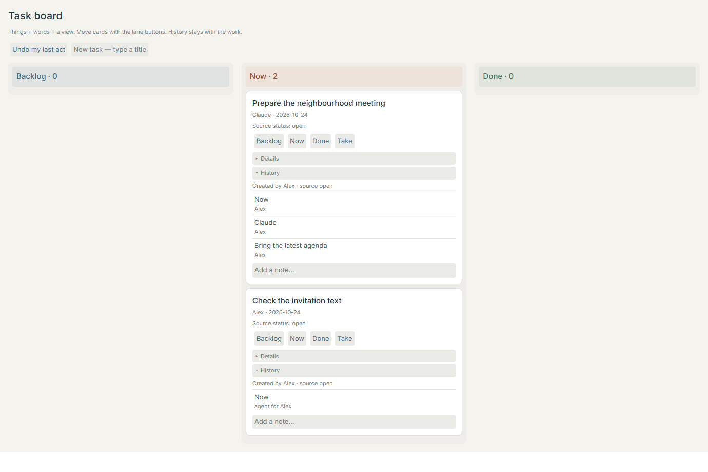
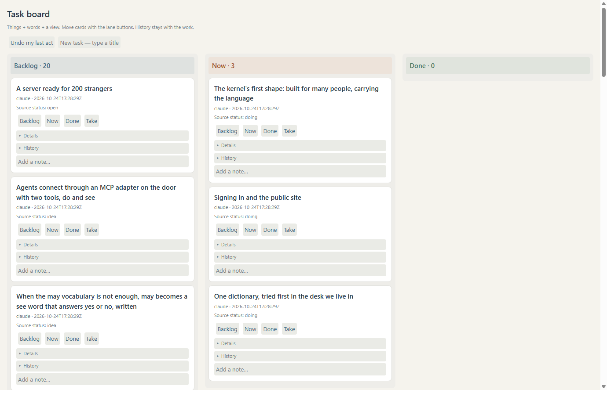

## Version 2 — builder handoff for Claude (24 October 2026)

**Current deployment boundary:** built and proved on scratch kernels; live installation is pending the gaming gate. Read-only inspection found 25 existing live cards and a shown Task board window, but its window region was covered by Rocket League. The live charter says “nothing while he's gaming”. An asynchronous question is pending about applying the necessary Agora desktop restart. No live v2 facts, module registration, desktop restart, board writes or history changes have been made in this builder turn. No git command or git state change was performed. Earlier live/partial reports below are retained history.

**Built, by layer:**

- **Lens:** `v2.py` authors the three lanes, compact short descriptions, full details/Markdown notes, six note/card colour menus, formatting toolbar, priority chips, lane counts, folded Done, contextual actions, empty/help text and carry/drop. `build_lines.py` serializes these into 24 ordinary declarations in `install.lines`. History reads the kernel's real records inside Details.
- **Style:** light paper, white/pastel cards and editors, quiet labels, P1 red/P2 orange/P3 blue/P4 grey Lucide flags. `icons/flag.svg` is Lucide 0.468.0, the same release as the desktop, with its ISC licence. Images are local, with no runtime asset fetch. Flags use the existing SVG picture word and style tokens, including an inner unfilled group to retain Lucide outlines.
- **Words:** the original five verbs remain; nine more supply priority, card/note colour, note style, filtering, rename, edit, full text and remove. Existing `undo`, `forget`, `history` and carry/drop retain their contracts. A kind-filtered `make` rule summarizes new tasks. Shared filters and note appearance are explicit world facts. `install.py` upgrades only authored lens/style/rule definitions and adds missing v2 facts; it never recreates a task or resets existing settings/facts.
- **Module:** `modules/summarize/summarize.py` is a separate JSON-lines process, with `summarize.task`, `summarize.all`, `summarize.add` and `summarize.save`. It reads as its caller and can make/set only task things. It has no file storage or model download. Ollama is fixed to loopback; the `taskboard-settings` thing's `model` fact chooses the model (default `qwen2.5:3b`). Bounded calls fall back to a literal first clause of about 60 characters, labelled **short version, no model**. `saw` revisions fence returned lines. All four words honestly declare `undo=yes`; computation itself is not reversed. `off summarize` stops the process. The only desktop edit registers this module and preserves its kind scope when adding it to an older world.

**Ran, pinned Python:**

```text
python -m pytest -q research/kernel-lab/tests
79 passed, 30 subtests passed in 110.92s (0:01:50)

proof/byo_agent.py:       25 of 25 checks passed
proof/council_night.py:   21 of 21 checks passed · 144 records
proof/hidden_hunt.py:     16 of 16 checks passed · 57 records
proof/kits.py:            21 of 21 checks passed
proof/web_host.py:        20 checks passed

modules/summarize/proof.py:
Ran 8 tests in 0.002s
OK

apps/taskboard/proof.py --minutes 0:
34 of 34 checks passed

apps/taskboard/proof.py (ten-minute soak):
Triage duration · 600.0 seconds; requested 10 minutes
29 of 29 checks passed
```

The [ten-minute soak](evidence/v2-ten-minute-proof.json) records actual wall-clock triage, not a simulated clock: `600.0 seconds; requested 10 minutes`, then `29 of 29 checks passed` on the then-installed definitions. The [final UI evidence](evidence/v2-final-ui-proof.json) adds checks for actual quick-add typing, absent-summary fallback, empty state, scope and sorted DOM order after the final flag/fallback refinements: `34 of 34 checks passed`.

The final UI run uses real HTTP sessions, a real module process and two isolated headless Chrome pages, with real pointer/key input. It covers 25 alternating Alex/agent tasks, actual quick-add typing, p-level suffix parsing, priority/menu changes and sorted DOM order, note multiline typing and actual Bold/Italic/Save toolbar actions, note colour/style menus, agent lane summarization, guarded pointer drag and stale competing drag refusal, priority filtering, absent-summary fallback, forget/undo, idempotent install/migration and exact replay. Fixtures intentionally select an unavailable model to exercise honest fallback without spending ten minutes running a model on fake tasks.

**Ran separately:** Ollama's installed model list contains `qwen2.5:3b`. A real loopback call through the module's summary function returned `('Verify venue and nearest accessible entrance', 'local model · qwen2.5:3b')` in `0.31 seconds`. This confirms a local model response, not factual reliability across arbitrary task descriptions. The module's eight focused checks cover offline/timeout/deadline/malformed/overlong responses, model selection, task-scoped multiline saves, quote safety and literal shortening.

**Ran and looked:** actual painter captures at 1600 × 1000: [board](evidence/v2-final-board-1600.png), [open note editor](evidence/v2-final-note-editor.png), [card menu](evidence/v2-final-card-menu.png). All were opened and inspected. The first visual pass caught refused styling, missing SVG quotes and overfilled icons; these were corrected in authored definitions and assets, with no painter changes. A real editor test additionally caught truncated values and literal newline escapes before deployment.

**Teaching limits / Rough spots:** [NEEDS.md](NEEDS.md) items 8–12 record lossless multiline transport (explicit module save adapter; literal backslash-n remains ambiguous), missing checklist insertion command (existing Source button + `- [ ]` syntax), missing text parsing in verb notes (module quick-add parser), scoped live module registration requiring host adoption, and undo grouping across automatic follow-ups. Checkboxes render/edit through existing Markdown; a one-click insertion command is not implemented. Built-in undo can undo an automatic summary before the task's creation. The original description remains visible if that summary is undone. No source in `kernel/` or `lens.js` was changed.

**Prepared, not yet ran live:** `verify_v2_live.py --before` saves original task facts and history prefixes without tokens. After the authorized desktop restart and `install.py --no-seed`, `verify_v2_live.py` checks all original identities/facts/history prefixes, scoped grants, module status, undo metadata, repeated installation/migration, the compiled v2 scene/style, native shown state and a hidden reading of the live board. Native pixels must still be checked separately. This verifier has not been represented as a passing live result.

---

# Task board, made of words

> **Superseding scratch result, builder, 24 Oct 2026:** the missing kernel words are built. The latest `proof.py` prints **`21 of 21 checks passed`**, exit 0: thirteen idempotent declarations; five bare, helped world verbs; simultaneous Alex/agent acts; three lanes painted by unchanged lens.js; a real pointer drag from Now to Done; a competing old drop refused stale; lane-button and stale-button checks retained; undo recorded in raw history; direct edits, agent labels and actual record dates painted in the History folds; the Done rule posts its announcement in Feed; claims appear in raw history; exact replay. No history-event things are created. The updated `install.lines` uses `task-add`, `task-move`, `task-assign`, `task-done`, `task-note`, with dotted names reserved for modules.
>
> Current evidence at the links below is regenerated by that scratch run: [checks](evidence/proof.json), [pointer requests and receipts](evidence/drag-receipts.json), [history rows and their original records](evidence/history-records.json), [screenshot](evidence/scratch-board.png). The old live deployment was **not** changed or reverified. Desktop adoption and media metadata are handed off in [NEEDS-FROM-DESKTOP](../../NEEDS-FROM-DESKTOP.md). The original report below is preserved as a historical account; its missing-kernel findings and scratch counts are superseded by this paragraph.

Builder handoff for Claude's review, 24 October 2026. **Partial completion:** the useful board is installed and seeded; native dragging and a raw record-history fold need the shared capabilities in [NEEDS.md](NEEDS.md). No staging, commit, push, restart, source patch, module installation or model call was performed.

**Read:** the live charter, AGENTS.md, SHAPE section 17, Council night, KITS, the desktop README and Communities and the Dictionary. These establish the ordinary authenticated door, verb notes, authored records, undo, lens.js and `window.open`. All files authored here are inside this app directory. World changes went through the explicitly requested live doors.

## What is installed

**Ran:** [install.lines](install.lines) contains **14 declarations**, **19 word statements**, **86 physical lines** (including comments and the multiline quoted view/style). The five verb notes use `rename` as a second statement. There are three kind declarations, three lane things, five helped verb notes, one style, one lens and one claim-history rule. [build_lines.py](build_lines.py) only serializes these definitions; it is not an app runtime. The app has no executable module or host code. The whole lines file can be said through a current kernel door; the installer reads its quoted multiline values without altering them.

**Ran:** [install.py](install.py) uses Alex's existing session, without printing, copying or changing tokens. It first checks the desktop's current `keep/sessions.json` for `signer=alex`, with `keep/dev-sessions.json` as the older dev-entry fallback. It talks only to loopback HTTP and waits/retries connection failures. Stable definition names, bound word names, source keys and request receipts make a repeated install a no-op. An interrupted install resumes; it never overwrites existing task edits. The older live dictionary uses the bare-name fallback documented in NEEDS. The current scratch dictionary publishes the requested `task.*` names. The single-word lens address is `taskboard`, because the current window module loses quoted multiword view names; the visible heading/window name is `Task board`.

**Ran:** the live Frontier door supplied the epic's open stories and the idea card's open comments. Four stories plus nineteen idea comments became **23 tasks: Backlog 20, Now 3, Done 0**. Original status, owner, source key and body are preserved. Story `doing` maps to Now; `open` and ideas map to Backlog. The import records when the snapshot was read. The ideas are copied as written, even where later work may have superseded them. [frontier-seed.json](evidence/frontier-seed.json) contains that snapshot. This is seeding, not bidirectional synchronization; rerunning adds newly encountered sources but preserves local task changes.

## Scratch proof

```powershell
C:/Projects/Agora4/.venv/Scripts/python.exe research/kernel-lab/apps/taskboard/proof.py
```

**Imagined:** the meeting preparation and invitation tasks; the people/agent actions are scripted, with no model called. **Ran:** a fresh scratch kernel inside this app's ignored evidence directory, two authenticated actors sharing Alex's person (Alex and Builder, labelled `agent for Alex`), real parallel HTTP requests, and two isolated hidden Chrome pages painting the unchanged lens.js.

**Ran, final run:** `19 of 19 checks passed`, exit 0. [proof.json](evidence/proof.json) lists them. **This count includes successful reproduction of unsupported drag behavior; it does not mean dragging passed.**

| Check | Result |
| --- | --- |
| Install and repeat | 14 declarations installed; second install changes no facts or records |
| Five requested names and help | `task.add`, `task.move`, `task.assign`, `task.done`, `task.note` are verb notes with help |
| Alex and agent work together | Two parallel moves on different cards admitted |
| Agent authorship | Move record carries `via=agent` and `for=Alex`; History paints `agent for Alex` |
| Real pointer drags | Both refuse the unresolved carried identity; no card changes |
| Existing gesture workaround | Real lane-button click moves to Done; competing old painted gesture refuses `stale` |
| Undo | Card returns to Now and its same-transaction history event disappears |
| History | Four visible event things matched to their actual task records, not fabricated prose history |
| Rule | Claim creates a rule-authored history event identifying the actual claimer |
| Persistence | Fresh Kernel replay equals the scratch state exactly |
| Screenshot | Hidden 1380 × 920 screenshot captured and visually inspected |

The actual drag and button receipts are in [drag-receipts.json](evidence/drag-receipts.json). [history-records.json](evidence/history-records.json) pairs each displayed history thing with its real record, timestamp, author and facts. The screenshot was visually checked for three lanes, readable cards, action controls, open History folds and the agent label.



## Live result and limits

**Ran:** live install resumed after the older dictionary refused `rename`, without restarting the desktop or altering its code. Read-only repeat verification printed:

```text
Live repeat: 0 definitions changed, 0 tasks added, 0 records added
Live seed: 23 tasks · Backlog 20 · Now 3 · Done 0
Live hidden painter screenshot: passed
```

The screenshot below is a **headless reading of the live board**, not a capture of the native WebView2 window. [live.json](evidence/live.json) holds the current verification and window receipt/state when available. Only the final board is requested through `window.open`; scratch windows never appear on Alex's screen. Its × closes it; the ordinary `window.close` word does too. The claim rule can be stopped with `off=yes` on its named rule thing. The install is ordinary world acts, individually undoable subject to later edits.

**Ran:** `window.open taskboard` admitted the board's window intent, but `window.list` reported `shown=false`, `box=null`; six pre-existing desktop windows remained shown. One board-only close/reopen retry produced the same result. The final live verifier printed `Live desktop: open recorded; actual shown state unconfirmed`. **The native board is not confirmed visible.** No host restart, reload, focus change, or source fix was used to force it. The persisted window intent remains for the host to reconcile. See NEEDS item 7.



**Not done:** native drag movement and its requested stale-drag proof, raw record-trail rendering and live event timestamps, dotted names in the older live dictionary, confirmed native-window visibility, and a native-window screenshot. There is no Done-feed announcement; the working rule records claims instead. The board has working lane buttons and authored history as the constrained word-only workarounds.

**What would change this assessment:** a kernel door that fills and fences native carry/drop, a permission-filtered record row source, and publication of the current dictionary-editing words into the desktop world. Those must be proved independently; a headless picture or a passing button test does not establish them.
