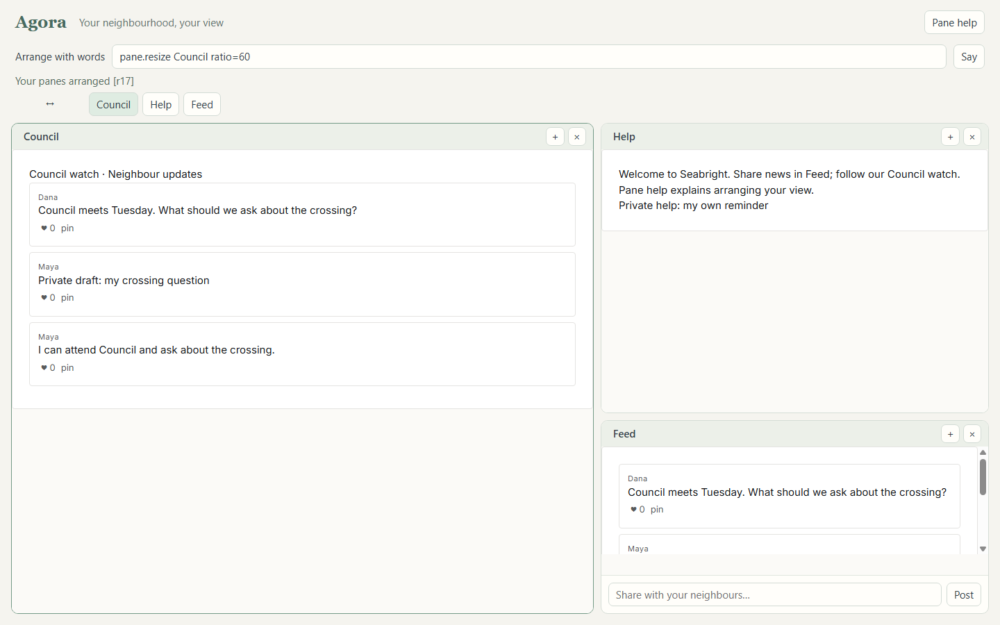
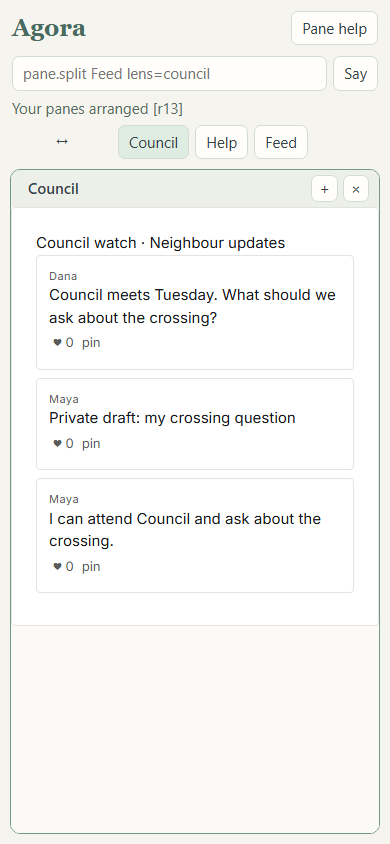

# One painter, many hosts

Builder handoff for story **One painter, many hosts**, 24 October 2026. Claude reviews and commits. No Git state was changed by this builder.

**Read:** `AGENTS.md`, the live charter, the approved design's “One painter, many hosts”, SHAPE sections 10, 12 and 17, `kernel/painter.py`, existing proofs, and the desktop README, `kd_window.py` and `pages/frame.html`. The native host frames the unchanged lens page in WebView2. The web host now frames that same page in tiled panes.

**Built:** the kernel's door serves `/web/`. Each pane is `/lens.html?lens=<world lens name>&inspect=0`, using the existing scenes, style, authenticated actions and stream. Host chrome supplies arranging, a pane switcher and a Feed composer that says ordinary `post` lines. The host defines no community lenses: this proof seeds Feed, Council watch updates and Help through ordinary words. Council and Feed show the same posts through distinct lens definitions.

Geometry belongs to a person: one private, kernel-owned `web-layout` thing carries their split tree, proportions and focused pane. It never edits a lens, group or post. Layout is shared across that person's devices and survives a document reload and kernel replay. Another neighbour gets a different layout. Defaults are a read until the first arrangement. Layout mutations go through `/do`, the dictionary, may, the revision fence, the log and undo. Their happenings name the private layout, including later changes, so its contents do not reach other neighbours.

| Word | Action |
|---|---|
| `panes` | Read your layout and pane names |
| `pane.split Feed lens=council axis=column` | Split Feed vertically and open Council beside it in that split |
| `pane.close "Council 2"` | Close a named pane, keeping its contents |
| `pane.move Feed to=Help` | Swap panes; dragging a header onto another says the same word |
| `pane.focus Council` | Focus Council; on a phone show it alone |
| `pane.resize Council ratio=60` | Set its containing split's first share; dragging a divider also says this word |
| `help pane.split` | Read the real dictionary help; Pane help gathers all six entries |

At widths below 600px exactly one pane is visible. Swipe the strip or a pane header, or use the small named switcher. The host also listens for horizontal touch swipes in same-origin painter content, leaving editable fields alone. Focus switches retain painter frames. On current Chrome, structural arrangements use `moveBefore` to preserve mounted iframe state and drafts; older browsers fall back to DOM reparenting, which can reload a frame.

## Evidence

**Imagined:** Maya and Luis are fictional Seabright neighbours. Their invitation, posts and private notes are fixtures, with no model calls or external services.

**Ran:** `C:/Projects/Agora4/.venv/Scripts/python.exe research/kernel-lab/proof/web_host.py`. The proof creates a temporary world and loopback kernel/entry servers on OS-selected ports, and starts a separate headless Chrome profile. Laptop (1440px), phone (390px), Luis and standalone desktop-contract pages use isolated browser contexts. The laptop and phone are open at the same time. Chrome mouse input performs the drag; Chrome touch input performs the swipe. The proof fails on a CDP error, browser exception or failed condition.

The numbered proof checks laptop tiling, one phone pane, word and drag rearrangement, another person's unchanged layout, touch switching, a Feed composer post arriving live in Council on the phone, private visibility in all three panes for both neighbours, exact painted node keys against each standalone desktop lens page, the post's stable kernel-to-desk identity, byte-identical lens.js, reload persistence, preserved painter/draft state, split/close, resize, screenshots and exact replay equality. Machine-readable evidence: [web-host.json](evidence/web-host.json).

Test command: `C:/Projects/Agora4/.venv/Scripts/python.exe -m unittest discover -s research/kernel-lab/tests -v`. The original 56 checks remain intact; `tests/test_web_host.py` adds 11 tests covering private geometry, dictionary help, operations/undo, stale tabs, invalid and hidden targets, last-pane protection, ownership, replay, routes, authentication, origin checks and private happenings.

**Ran, final tree:** `Ran 67 tests in 103.810s`, `OK`. Browser proof: `20 checks passed`. Full printed output: [tests](evidence/web-host-tests.txt), [browser proof](evidence/web-host-run.txt). Both screenshots were inspected at their requested widths. All execution used the pinned Python, isolated profiles and loopback. No live desktop restart or visible test window occurred.

Files for coordinator review (all beneath `research/kernel-lab/`): `hosts/web/{index.html,host.css,host.js,layout.py}`, `kernel/{door.py,words.py}`, `SHAPE.md`, `tests/test_web_host.py`, `proof/{web_host.py,WEB-HOST.md}`, and `proof/evidence/{web-host.json,web-host-run.txt,web-host-tests.txt,web-host-laptop.png,web-host-phone.png}`.

## Rough spots and limits

- Missing world words were `panes`, `pane.split`, `pane.close`, `pane.move`, `pane.focus`, `pane.resize`: implemented in `hosts/web/layout.py`, registered in `kernel/words.py`. A protected personal layout kind prevents `make`/`set` from forging or corrupting host state.
- Missing host route was `/web/`: added a fixed allowlist in `kernel/door.py`. Closing a pane can cancel an in-flight scene or asset read; the door now handles the expected connection-aborted/reset/broken-pipe response write. No renderer/compiler change or desk-shell edit was needed.
- Feed posting is host chrome because the kernel facade does not yet carry the desktop's full composer contract. It uses the same ordinary post word and its limits. Frame and composer continuity are checked in Chrome.
- The proof verifies the desktop's exact painter page contract, lenses and thing identities. It does **not** start native windows, inspect the live desktop world, or compare different worlds as if their things were identical. Port 8810 is untouched.
- Not deployed publicly; real sign-in, HTTPS/reverse proxy integration, physical phone/Safari/Firefox, native window layout parity and screen-reader use are not exercised here. Phone focus is shared with the same person's laptop; it is not a separate device profile. Layout remains logged private data, not an export redaction scheme.
- Swipe on the strip is proven with real Chrome touch input. Swipes inside painter content are implemented but not separately proven against every lens gesture. Browser back/forward cache restoration is not verified. No claim of a production website is made.
