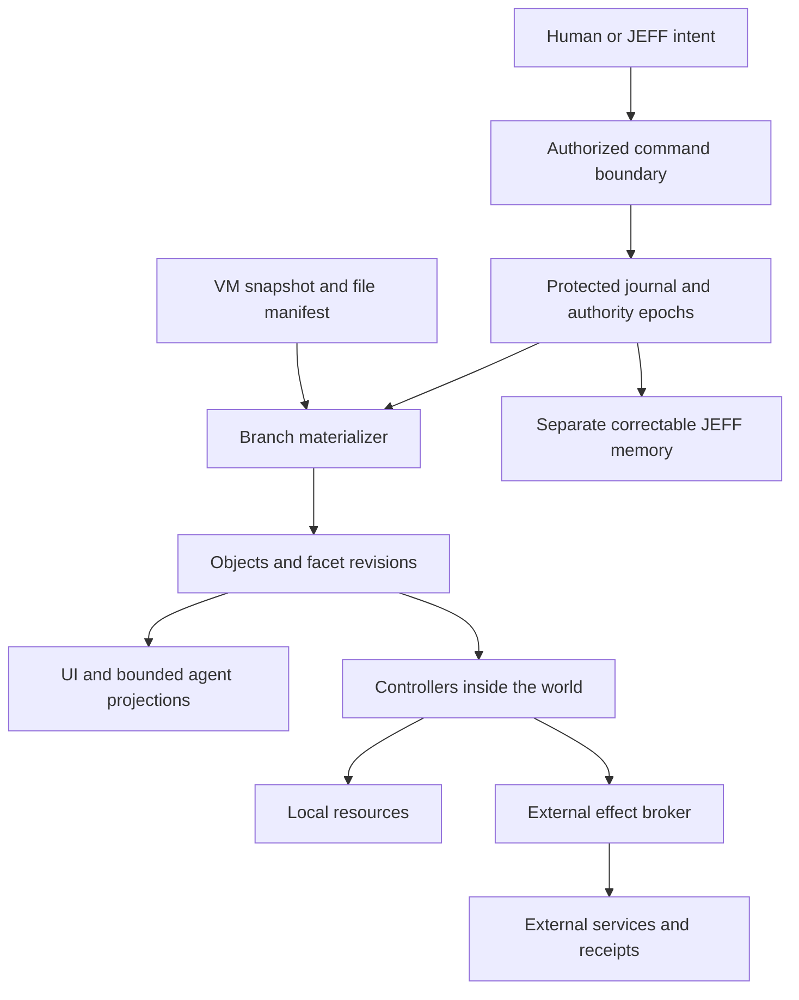

# Agora objects and facets: a design pressure test

Initial research and experiments completed August 31, 2026; subsequently revised at the user's request to evaluate a whole OS rather than center idea-to-prototype work. The core specification, object design, and facet explanation have now been revised. This object review did not edit the Constitution or the separate security assessment; security work proceeded separately. Historical comparisons below retain the initial research; no new web research was used for the whole-OS revision.

**Scope correction:** a development workflow is one useful stress test, not the product backbone or sufficient evidence for a general object model. The current proposal is constrained by reading, listening, communication, scheduling, files, devices, private state, transient data, and large application models. See [Object Use Cases](<C:/Projects/Agora/Object Use Cases.md>) for the expanded reasoning. The [initial assessment](C:/Projects/Agora/research/whole-os-object-review/before-revision/initial-assessment.md) and [earlier core documents](<C:/Projects/Agora/research/whole-os-object-review/before-revision/Agora Objects.md>) are preserved for comparison.

The working materials are the [concrete example world](C:/Projects/Agora/research/object-facet-review/example_world.json), [executable counterexamples](C:/Projects/Agora/research/object-facet-review/toy_models.py), and [recorded results](C:/Projects/Agora/research/object-facet-review/results.json). The principal local sources were [Agora Objects](<C:/Projects/Agora/Agora Objects.md>), [Facets](C:/Projects/Agora/Facets.md), the [core spec](<C:/Projects/Agora/Agora Spec.md>), the [Constitution](C:/Projects/Agora/CONSTITUTION.md), and the [rooms proposal](C:/Projects/Agora/Untitled.md). Historical descriptions below are source-backed; architectural recommendations and example policies are my assessment, not reported facts about an implemented Agora system.

**My judgment**

There is a credible system here. Its strongest idea is continuity: a person and their agent can work on the same identifiable things, across tools, sessions, representations, and experiments, without repeatedly rebuilding context. Facets are a reasonable way to express that continuity without requiring a universal class hierarchy.

The initially reviewed documents underestimated the work required to make that continuity truthful. Several of the following gaps are now addressed as design requirements in the revised core documents, but remain unimplemented. Two editors can reference the same entity without being able to merge their edits. An event can record a file path without preserving the file. A restored call record cannot safely be treated as permission to activate the microphone. An action can be discoverable without being authorized. A summary can have provenance and still mislead JEFF.

Agora's object subsystem can start as a persistent workspace protocol with enforced boundaries, specialized tools, and an agent that helps bridge imperfect semantics. That subsystem is only part of an OS. Scheduling, drivers, networking, storage durability, accessibility, application lifecycle, account integration, and recovery retain their own substantial engineering obligations. An object-oriented replacement kernel is not required to test the object contracts; the proposed Linux VM provides a place to start, not a shortcut around those obligations.

I would keep stable identities, composition, explicit provenance, spec/status for appropriate resources, ordinary file interoperability, replaceable renderers, and a common action contract for humans and agents. I would not freeze the six-field record yet, treat all facet combinations as executable, or make correctness depend on JEFF understanding everything.

The central requirement is: **ordinary subjects remain coherent and usable as applications, locations, sessions, and circumstances change.** This includes reading an unchanged document, listening to music, receiving messages, and using a device. Independently built tools improving the same existing data is one valuable test, but it does not by itself establish that the model fits an OS. Successful consumption, communication, organization, and maintenance are outcomes in their own right.

**1. What objects should mean in practice**

An object should be a durable subject that a person can refer to, grant access to, revisit, or act on. It is not necessarily a file, a process, a visible card, a programming-language object, or an indivisible storage record. Those are different implementation concerns.

Facets answer questions about that subject. What content does it have? Where are its bytes? What state is requested? Which observations are current? What operations does an installed tool implement? Some answers are authoritative, some are derived, and some are claims. Making those categories explicit matters more than finding the perfect facet names.

Three operations that the earlier prose sometimes blended together should remain distinct:

| Operation | What remains the same | Example |
|---|---|---|
| Enrich an entity | The subject | Add a checklist, alias, or due date to an existing note. |
| Derive another entity | A provenance relationship | Export an independently editable crop of a photo. |
| Add a representation | The underlying subject and content | Open a note as an outline and as a text editor. |

**The recording, its queue entries, and its player.** A recording's content, appearances in a playlist, and current playback state concern different referents. The same recording can occur twice; moving the second entry must not move the first. The playback session can remain meaningful when its selected entry is removed from the queue. Pausing or closing a player does not delete the recording.

My default representation would be:

```text
recording_8 — media content, source bindings, descriptive metadata
  ├─ appears as → playlist_4 / entry_11
  └─ appears as → playlist_4 / entry_13

playback_session_2 — selected entry, position, desired/observed output

player view: presents recording, queue, session, and controls together
```

The user need not see separate administrative cards. **A unified experience does not require a single giant entity.** Give independently addressable subjects their own identity; keep small dependent attributes together. Different privacy or perspective alone does not require duplicating the subject: private reading position and per-person annotations can be scoped facets or overlays over one document. This refines the initial proposal, which was too quick to recommend identity splitting for every permission boundary.

**A PDF with annotations.** The PDF's captured bytes are authoritative for that revision. Extracted text is a derived representation, not a second independently writable version of the document. Highlights need anchors tied to a content revision and page/region or text positions. When the PDF changes, anchors may become stale. A summarizer cannot repair that merely by retaining the entity ID. Give the user a visible reattachment workflow and preserve the original anchor.

**A dataset in a table and a chart.** This is an excellent facet use case. The table and chart share a dataset identity; chart configuration is separate from data; calculated values retain dependency revisions. But editing a chart does not automatically imply a valid inverse transformation back into the dataset. A renderer can be read-only. Bidirectional editing requires an explicit contract, especially for grouped, filtered, or aggregated data. Units and missing-value semantics must become typed wherever computations depend on them.

**A legacy editor.** Treat the document, editor session, and window as distinct when needed. Closing a window must not delete the document. Relaunching an editor does not recover an unsaved buffer unless the editor or a checkpoint captured it. A wrapped application still controls its private format and internal state; wrapping gives Agora context and control points, not ownership of every semantic operation inside it. Mark the integration's actual abilities: inspect metadata, read content, edit structurally, observe changes, restore session, export.

**Two views of the same thing.** A room participant may want the dataset at one position while Alex wants it somewhere else. Store layout against a view/placement identity, not as one globally authoritative transform on the dataset. Shared layout is a deliberate shared view. Surface bindings, focus, and pointer targets should identify participant and session and expire when those sessions end.

These examples suggest a useful boundary: identity belongs to the subject; layout belongs to a view; process identifiers belong to a runtime incarnation; historical content belongs to a revision; authority belongs to a grant.

The revised example world covers a document with private reading state, repeated playlist entries and a paused player, a conversation and frozen message submission, a recurring appointment and reminder, and a disconnected printer with an uncertain job outcome. It uses symbolic IDs and hypothetical sources; it does not launch anything, submit jobs, or issue permissions. The earlier development-only example is archived with the initial assessment.

**2. A facet needs a contract, not just a JSON shape**

The absence of an entity class hierarchy does not mean an absence of types. `text`, `service.spec`, and `parametric-model` are types. Avoiding inheritance removes one source of rigidity; it does not eliminate semantic compatibility requirements.

For each facet definition, a practical registry should describe:

| Contract | Why it matters |
|---|---|
| Namespaced identity and schema version | Two packages must not silently disagree about what `status` means. |
| Cardinality and instance identity | An entity may have multiple files, languages, views, or service bindings. |
| Value revision | Schema version 2 and content revision 42 are different coordinates. |
| Authority class | Human intent, controller observation, derived cache, or attributed claim. |
| Read/write policy | Private annotations may coexist with shared content. |
| Mutation operations and validation | Safe editing is more precise than replacing an entire entity document. |
| Dependencies and invalidation | Summaries, signatures, thumbnails, and indexes must know when inputs change. |
| Merge/conflict behavior | Some updates merge; others require rejection, branching, or coordination. |
| Handler compatibility | A renderer or action declares which versions and features it understands. |
| Projection and export fallback | Missing software must not make surviving data invisible or inaccessible. |
| Size and resource limits | Schemaless metadata is still untrusted input that can exhaust resources. |

This is more machinery than a bag of stickers. It is also where the system's guarantees actually live. Do not expose all of it to every user or require every plugin author to reinvent it: provide standard contract profiles and generated plumbing.

For an initial implementation, use one canonical stored schema per facet instance at a branch head. Preserve old schema-tagged revisions and provide declared readers/migrations. Do not maintain freely writable v1 and v2 copies of the same logical value. Otherwise independently versioned facets acquire a synchronization problem inside themselves. Explicitly model a translated representation as derived.

Project Cambria is useful research here: it models schema evolution through translations and documents cases where compatibility cannot preserve every user's intent. It is evidence that migration deserves its own design, not evidence that a particular library should be adopted without evaluation. [Cambria research](https://www.inkandswitch.com/cambria/)

**Unknown facets: preserve data, restrict operations.** Suppose an old text editor preserves an unknown signature facet while changing the text it signs. No bytes were lost, but showing the signature as current is now false. Likewise, an unknown execution constraint cannot be ignored by a handler that depends on satisfying it.

Use separate rules:

1. Storage and transfer preserve admitted unknown facet payloads within quotas.
2. Generic inspection displays their identity, version, provenance, and availability without executing supplied code.
3. Actions declare what they understand and require. Unknown critical requirements block that action.
4. Derived facets become stale when declared inputs change, even if their payloads remain intact.

This preserves extensibility without allowing an unfamiliar component to change the meaning of a supposedly safe action. The registry or broker must know the relevant dependency envelope; an opaque payload cannot enforce its own restrictions by declaration alone.

**Any combination may be representable; not every combination is valid or runnable.** A service spec without a compatible runtime is incomplete. Two bindings may compete for the same resource. A published revision cannot simultaneously be an uncommitted working buffer. Conflicted and incomplete objects should remain inspectable, but execution must be gated.

Optional profiles such as `editable-text` or `local-service` can name tested combinations and supply defaults. Profiles must not become hidden entity classes: actions still test explicit requirements, and users can compose outside a profile. A kind-tag remains descriptive.

Three ambiguities identified in the initial review are now corrected in the core proposal. An empty facet bag does not by itself mean tombstone; lifecycle is explicit. Human task status such as “in review” does not share the authority semantics of reconciler-owned runtime status. And `derived-from` has one authoritative representation rather than being independently writable in both a provenance facet and an edge table; a convenience facet can be derived from the edge record. Implementations still need to enforce these distinctions.

**3. What the smallest useful record could look like**

This is a candidate logical model, not a proposed final wire format:

```text
EntityIdentity:
  id, origin_authority, genesis_event

EntityAtBranchHead:
  entity_id, branch_id, head_revision, lifecycle, policy_ref
  facets: [FacetInstance...]

FacetInstance:
  instance_id, namespaced_type, schema_version, value_revision
  payload_or_content_ref, provenance_ref
  dependency_revisions, validity

EntityRef:
  entity_id, branch_selector, optional_revision, optional_subobject_anchor

ActionRequest:
  action_contract, handler_version, target_refs, arguments
  expected_read_revisions, grant_ref, authority_epoch, operation_id
```

Not all these fields must be duplicated in every serialized record. Some can be derived from events or supplied by the request context. The point is to settle the distinctions before optimizing representation.

One facet instance should be atomic enough to preserve its internal invariants and narrow enough to authorize and merge sensibly. A `name` can be a small scalar facet. A CAD model should not become millions of independent world entities merely because it contains millions of elements. Keep efficient domain storage behind stable subobject anchors; promote an element to a world identity when cross-tool reference or separate permissions justify it.

Avoid both extremes: an entity for every scalar creates overhead; a single `metadata` object containing private notes, publication settings, and runtime instructions defeats meaningful facet scoping.

Freeze principles and compatibility rules early. Freeze the smallest identity/reference protocol after it survives migration and rollback exercises. Thousands of objects are a reason to build migration tools, not evidence that all future schema changes must become impossible.

**4. Authority is the first serious architectural constraint**

A globally unique ID is a name. It is not automatically an unforgeable authority. An importer can copy or claim an ID; origin authentication and collision handling are separate concerns. A leaked ID should not grant access. Snapshot clones also need an identity issuance strategy that does not replay the same generator state.

An action descriptor says what an installed handler supports. A grant says what this caller may cause. Current availability says whether that action can run now. These must remain distinct:

```text
offered action = compatible handler + satisfied structural requirements
permitted call = offered action + current authorization + valid arguments
safe dispatch = permitted call + checked revisions + allowed side effects
```

Object-capability systems treat authority as protected references, not descriptive strings. E is a useful comparison for this distinction. Agora can use a brokered hybrid, but an `acl` field and a list of actions are not by themselves capability security. [E's authority model](https://www.erights.org/elang/kernel/auditors/index.html)

The COM analogy should also stay limited. `QueryInterface` provides interface discovery, but COM requires the interface set of an object instance to remain static. Agora's installable, removable behaviors need versioned discovery and invalidation rather than copying those semantics wholesale. [Microsoft's QueryInterface rules](https://learn.microsoft.com/en-us/windows/win32/com/rules-for-implementing-queryinterface)

**Writing a spec is exercising power.** A worker permitted to write `prototype.spec` can induce a privileged reconciler to run commands, mount paths, open network access, or publish artifacts if those fields are unconstrained. Restricting the worker from writing `status` does not solve that confused-deputy problem.

Grant the authority to cause specific effects: run this approved handler against this granted directory, with this resource ceiling and network policy. Validate the complete induced effect at dispatch. A directory path string is not a grant; resolve through scoped resource handles and enforce access below the interpreter, including symlink and path traversal behavior.

If code running as root in the world VM can rewrite the policy database or the event log, those stores do not constrain that code. This is a threat-model fact, not a missing annotation. The host boundary protects the host; it does not automatically protect everything inside the VM from JEFF or a compromised privileged component.

For strong guarantees, put authoritative grant issuance, revocation epochs, protected journal admission, and external-effect mediation in a service outside the mutable world. Keep the supervisor itself small; it can manage a separate protected service rather than absorbing every database and plugin into host-root code. Authenticate event writers at that boundary. Record a worker's claims as worker claims, even when a world process relays them.

If the initial prototype instead trusts JEFF's world-root access, say so clearly: its facet ACLs protect well-behaved participants or separately sandboxed workers, not a compromised root executive. Both prototypes are possible; their guarantees differ substantially.

**Parity should mean shared semantics, not identical permissions.** Human controls and agent calls should use the same action implementation, validation, revisions, errors, and audit trail. A human can still have broader authority than a worker. The UI can explain a denied action without granting it. Recheck authorization when executing: a menu displayed before revocation is not a lasting permission.

Handcrafted interfaces remain useful. Dragging a trim handle or manipulating geometry cannot be reduced to a good generic form simply because the action has JSON arguments. The important parity test is that UI and agent edits pass through the same semantic operation boundary.

Sharing a tool in a room should offer installation, not execute it automatically. Separate data receipt, package installation, and activation with granted powers. Renderers, projectors, importers, schema migrations, and preview handlers are code and require isolation too. A package's signature authenticates its publisher; it does not prove the code harmless. Package updates must not silently acquire broader grants.

JEFF may invent a new data vocabulary without waiting for a standards committee, within its creation grant and storage quota. That does not entitle the invented facet to become a trusted observation, modify platform policy, or install executable behavior. A facet definition describes requested semantics; the trusted registry and broker decide which semantics and authority the platform admits.

**5. The event log needs an exact scope of truth**

The earlier specification placed the world event log inside the domain that gets rolled back while also promising post-snapshot object resolution and an unrevised record. Those promises did not follow from that placement. The revised core now requires retained recovery evidence outside the restored state; the following explains the design pressure behind that requirement.

Example: snapshot at event 100; create object X at 120; JEFF remembers X; restore event 100. If the only genesis and object record were in the restored store, no resolver can recover X's identity merely from a lineage field that no longer exists.

A workable split is:



The diagram shows logical responsibilities, not a requirement for twelve processes. The journal and authority state survive world restoration. Restoring selects or creates a branch rooted at a recorded checkpoint. It appends an event describing that branch operation rather than deleting the abandoned future.

For the initial system, use a serialized writer per world branch. A distributed multi-writer journal can wait. A reference needs a branch or revision interpretation; `World(t)` alone becomes ambiguous once two valid futures exist. Prefer `World(branch, revision)`, with wall-clock time as a query convenience.

Distinguish resolution outcomes: present, historical-only, absent-on-this-branch, erased, inaccessible, and unknown. The user-facing interface may present a historical placeholder as a tombstone, but do not destroy the object on branch A just because branch B does not contain it. Do not reveal a private object's existence through an unauthorized resolver.

**Rollback also affects authority and ongoing work.** A grant revoked after a snapshot must not become valid when an old ACL returns. Old workers and controllers may still deliver responses. Numeric revision 3 on the old future is not revision 3 on the new future. Bind mutation requests to a branch/incarnation and use an authority epoch outside the rollback domain. Fence old controllers and reconcile status afresh after restoration.

**A path is not history.** If an event records `/project/note.txt`, and a conventional editor later changes that file, replaying the old event retrieves the new bytes. To reconstruct content, keep immutable content revisions, diffs with retained bases, or snapshot manifests identifying captured bytes. The log may reference these artifacts; it cannot replace them.

Therefore the honest promise is: authoritative object state is reconstructible from retained events, referenced payloads, and declared snapshot checkpoints. External files and services are authoritative for their own mutable state until captured or observed. Full historical reconstruction is conditional on the retention and capture policy. Database corruption, blob corruption, and loss of the entire disk are different recovery cases and need different protections.

Select a clear authority mode per content binding:

| Binding mode | Authority and write path |
|---|---|
| Native content | Object operations or immutable content revisions are authoritative; exported files are materializations. |
| External file | The file is authoritative; watchers create observations and captured versions. Writes use conflict checks. |
| Remote resource | The service is authoritative; facets record an observed revision, freshness, and pending operations. |

Do not casually make a plain-text facet and a file both writable primary copies. Avoiding duplicated authority is one of the most concrete lessons from the Nepomuk maintainer's account. [Nepomuk design retrospective](https://mail.kde.org/pipermail/nepomuk/2013-December/004858.html)

File watching is an optimization, not a complete journal. Add periodic reconciliation, overflow recovery, rename/replace detection, and revision checks. A rename, a copy, a hard link, a restored file, and a different file at the same path need different identity decisions. Preserve ambiguous matches for review instead of automatically merging identities because their bytes happen to match.

**Recording and explaining have different granularity.** Saving only one event at the end of an editing session loses acknowledged work if the session crashes. Persist operations or checkpoints frequently enough to meet the durability promise; group those durable operations into a human-readable activity record. Likewise, compaction must retain sufficient bases and reducer/schema versions for the supported recovery horizon. A prose summary is not a replayable delta.

Replay must be pure. Rebuilding an entity cache must never send an email or restart an external job. Derived embeddings need not reproduce bit-for-bit unless their model and configuration are fixed; distinguish rebuildable functionality from exact reproducibility.

**6. Spec/status is valuable, but not a universal execution model**

Use desired state for convergent resources: a local preview server should run, a download should reach a verified artifact, a workspace should mount certain allowed content. Controllers need explicit ownership, bounded retries, backoff, resource limits, and visible failure states. Kubernetes documents controllers as attempts to bring observed state closer to desired state; it does not promise unconditional convergence. [Kubernetes controllers](https://kubernetes.io/docs/concepts/architecture/controller/)

At minimum, service observations need the spec generation they describe, runtime incarnation, observer identity, controller lease/fencing value, observation time, and validity interval. `healthy` with a PID is insufficient. PIDs, ports, and surface handles are runtime coordinates and may be reused. Mark status unknown immediately when the incarnation changes.

Restoring a preview can be automatic within previously granted limits. Restoring a world must not replay old intent to send a message, make a purchase, delete a remote dataset, or publish an artifact. Those are operations with durable IDs, explicit effect policies, and independently tracked outcomes.

Even an outbox has a hard limit: a service may perform an operation and the caller may crash before recording its receipt. A durable pending record cannot tell you whether the operation occurred. Receiver-side idempotency or an independently queryable result is needed for safe automatic retry. Otherwise use `outcome_unknown` and inspect; a compensating operation may be available but is not time travel. Temporal documents this exact distinction between durable workflow history and potentially repeated activity execution. [Temporal activity semantics](https://docs.temporal.io/activity-definition)

Keep operation IDs and receipts outside the rollback domain. Bind IDs to arguments to prevent reuse with changed payloads. Prevent both sides of a fork from controlling the same external resource unless an explicit ownership policy permits it. A controller lease alone is insufficient if the receiving resource cannot reject commands from stale lease holders; enforce fencing at the broker or resource that accepts effects.

There is also an unglamorous issue with salience: a forgotten desired-state object can keep a server, GPU, or remote service running. Separate attention, storage retention, and execution budgets. Background work needs leases or quotas, user-visible cost, and explicit stop rules.

**7. Concurrency needs more than CRDT-per-facet**

Two writers can each make a valid change to separate facets and together violate an invariant. In the toy model, two allocations start at 40 each under a total limit of 100. Each writer reads 80 and changes its own allocation to 60. Independent facet revisions allow both writes: total 120. Checking the complete read set at an atomic commit rejects the second stale proposal.

This is why an action contract needs its read dependencies, not only its write targets. It may need an atomic transaction across several facets or entities. SQLite transactions are a reasonable local starting point; optimistic version checks can reject a stale edit before a single writer commits it. Kubernetes provides a useful example of conditional updates and explicit conflicts. [Kubernetes API update semantics](https://kubernetes.io/docs/reference/using-api/api-concepts/)

Convergence is not validity either. Two replicas can independently add valid dependency edges and merge into a cycle. A scheduler that merely sees a converged graph can deadlock. Coordination requirements depend on the operations and invariants, not on whether every field uses a CRDT. [Bailis et al., Coordination Avoidance in Database Systems](https://www.vldb.org/pvldb/vol8/p185-bailis.pdf)

Suggested initial policies:

| Data | Initial policy |
|---|---|
| Short names and preferences | Conditional update; explicit conflict or chosen last-writer behavior where harmless. |
| Collaborative text | Mature text CRDT with its original operation history and undo semantics. |
| Code and opaque binaries | Worktree/version branch and review; binary conflicts remain alternatives. |
| Specs with coupled constraints | Atomic command validation against all relevant current revisions. |
| Runtime observations | One current authoritative observer per responsibility; fenced replacement. |
| Grants and revocation | Protected, coordinated policy service; do not merge grants with permissive set union. |
| Semantic claims | Attributed additions and retractions; disagreement remains visible. |
| Derived content | Dependency-aware invalidation and recomputation. |

No generic merge function can know whether two different executable scripts implement the same user intent. JEFF can propose a resolution and explain it; the resolution should still be a recorded operation rather than silent rewriting of either author's contribution.

Even ordinary undo needs scope. Undoing a rename is easy. Undoing the creation of an entity now referenced by a collaborator is not. Use actor-scoped semantic undo, inverse operations with preconditions, or a branch—not unconditional restoration of somebody else's intervening work.

**8. Token projection is one of the best ideas, if it is treated as evidence selection**

The proposed `facet.project(budget) -> text` interface is too narrow for correctness and too powerful if arbitrary imported facets supply executable projectors.

A more useful contract is:

```text
project(entity_revision, viewer, purpose, budget, freshness_policy)
  -> facts, attributed_claims, source_refs, omitted_detail, stale_dependencies
```

Trusted platform code supplies identity, revision, authorization-relevant state, conflict indicators, and provenance framing. Domain projectors can add content inside that frame, with bounded resources and no ambient file/network access. Unknown facets use a generic representation; they do not need to ship runnable code for the platform to preserve and inspect them.

Consider a cached summary saying “the appointment is tomorrow at nine” after one occurrence is moved. Retaining the summary's author does not make it current. The projection needs the occurrence reference, schedule revision, time semantics, and freshness before that description influences a reminder or message. Likewise, “printer ready” cannot override an expired device observation.

At every display size, preserve an irreducible envelope: identity/reference, relevant revision, freshness/conflicts, and whether statements are observations or attributed claims. If the budget is too small, omit the object with an explicit omission signal rather than truncate away qualifications. An actionable object gets enough space; ambient objects can be omitted and fetched on demand.

The toy projection experiment uses whitespace units, not a real model tokenizer. It verifies only that a small envelope is never truncated across 13 budget settings. It does not measure comprehension or prevent prompt injection.

Permission filtering must happen before retrieval, joining, summarization, and embedding use. A private budget summarized into a public description is still private information. Derived content should inherit the permitted readership of its inputs unless an authorized declassification process intentionally produces a shareable result. Cache keys must include revision, viewer/policy context, projector version, and purpose; revocation must invalidate relevant cached projections.

Provenance is evidence about a claim, not proof of the claim. A trusted worker can be wrong; several workers can repeat the same contaminated source. Track source dependencies so retraction can invalidate descendants. Confidence should be attributed and calibrated for a defined task, not treated as a universal numeric probability of truth.

Low-trust markup does not guarantee that an LLM ignores injected instructions. The effective protection is that reading a description grants no new powers, and a mistaken plan must still cross constrained action boundaries. A fully privileged executive can remain dangerous even with excellent provenance labels.

**Soft semantics should help find candidates, not silently authorize facts.** “The thing from last week” can retrieve a shortlist. “Publish the approved version” requires a precise object revision and approval record. A discovered pattern can become a typed facet only after validation and an explicit promotion step. Preserve the original annotation and the derivation explaining the promoted value.

**Shared attention is temporal.** “Move this there” may refer to the object pointed at when speech began, while the pointer has moved by the time recognition finishes. Use a timestamped interaction context with participant, session, view, selection, and subobject anchor. Freeze the intended referent for the action, show a lightweight highlight, and disambiguate when uncertainty or consequence warrants it. Salience alone is not reference resolution.

Also distinguish observed user attention from agent-estimated relevance. A worker must not be able to promote itself into JEFF's focus by writing a high salience value. Presence needs privacy, expiry, and admission limits.

**9. Rooms, deletion, and memory reveal limits that should be stated honestly**

Replicating events is not the remaining small step to multiplayer. Partial replication, causal order, schema negotiation, offline conflicts, malicious peers, encrypted access, group membership changes, and external-resource ownership each need a protocol. Remote objects must expose unavailable, stale, pending, and uncertain states. This is consistent with the long-standing warning against hiding distribution behind ordinary local-object semantics. [Waldo et al., A Note on Distributed Computing](https://waldo.scholars.harvard.edu/publications/note-distributed-computing)

“Bring this into the room” is underspecified. It could mean share the current revision, share selected live facets, or publish a redacted copy. Sharing the whole entity could expose private annotations or history. Show the sharing scope and keep personal overlays separate. A semantic edge to a private object is not authorization to traverse or disclose it.

Revocation stops future authorized access; it cannot force an untrusted recipient to forget plaintext already copied. Offline replicas cannot instantly learn a revocation. For sensitive operations, require online authorization or short leases; define which offline edits can be proposed and which can become authoritative only after revalidation.

The Constitution simultaneously promises erasure, an unrevisable record, and complete usable forks of shared history. The current wording cannot guarantee all three for arbitrary recipient-controlled copies. Article I's stated precedence helps interpret intent, but it does not provide a deletion protocol. This review does not change those articles.

A realistic technical policy would distinguish immutable minimal event envelopes from erasable payloads, indexes, projections, and memory derivatives. If using per-content encryption, key destruction must cover all relevant copies and backups; encryption is not proof that recipients lack plaintext. Even a retained hash, entity ID, relationship, or author record can itself expose sensitive information. The design must specify what survives erasure and why, without promising control over third-party copies.

Likewise, memory surviving rollback should not mean memory is uncorrectable or immortal. JEFF needs retractions, disputed claims, expired observations, and deletion of derived summaries. If personal content is incorporated into model parameters or adapters, reliable later erasure becomes a separate unresolved problem. Keep erasable personal memory outside trained parameters until there is a defensible policy.

Finally, low attention is not permission to delete. An old family photo, cryptographic key reference, or dataset feeding a job may be rarely focused and still essential. Use lifecycle for discoverability; use explicit retention policy, pins, dependency leases, and curation for deletion. Tombstoning an entity does not reclaim its content from an append-only history by itself.

**10. What prior systems actually tell us**

The failure table in the [earlier object document](<C:/Projects/Agora/research/whole-os-object-review/before-revision/Agora Objects.md:22>) was too confident about historical causes. The revised core removes that causal framing. The assertion that predecessors died because machines could not read is not supported. Nor does the survival of one mechanism establish that all competing designs failed. Several lines of work survived in narrower forms.

| Comparison | What the evidence supports | Implication for Agora |
|---|---|---|
| WinFS | Microsoft's contemporary description included Win32 access and metadata integration over NTFS. Its researchers also developed explicit replication and conflict handling. This was more than a proposal to lock ordinary files away. | File compatibility is necessary but not a novel answer to every WinFS problem. Avoid assigning one unproven cause to the project's fate. |
| Nepomuk / Baloo | The maintainer described developer complexity, desktop resource costs, duplicated data, and ambiguous APIs; the replacement narrowed the problem. | Establish authoritative stores and cheap useful queries before adding more semantics. |
| OpenDoc | Its architect described extensible components and substantial cooperation over rendering, events, and storage. | Agora inherits composition and integration work; eliminating a class hierarchy does not eliminate it. |
| Smalltalk-related persistence | GemStone documents transaction logs and recovery. Persistent object systems are not inherently unable to record history. | Choose persistence semantics on requirements rather than a categorical obituary for object worlds. |
| KeyKOS / EROS | Persistent capability operating systems implemented protected object references and consistent checkpoints. | Object persistence and capability enforcement are engineering disciplines with precedents, not functions supplied by an LLM. |
| Ink & Switch | Local-first work pursues ownership plus collaboration; Patchwork explores multiple tools over shared documents and AI-assisted extension. | Study contemporary systems as close relatives. Agora's differentiator must be demonstrated integration across work, execution, and recovery. |

Sources supporting those rows: [Microsoft's WinFS architecture article, Japanese edition](https://learn.microsoft.com/ja-jp/previous-versions/msdn/architecture-center/cc440131%28v%3Dvs.71%29), [Microsoft Research on WinFS replication](https://www.microsoft.com/en-us/research/publication/peer-to-peer-replication-in-winfs/), [Nepomuk maintainer's retrospective](https://mail.kde.org/pipermail/nepomuk/2013-December/004858.html), [OpenDoc architect's extension article](https://preserve.mactech.com/articles/mactech/Vol.10/10.08/OpenDoc2/index.html) and [Apple's part-handler article](https://vintageapple.org/develop/pdf/develop-19_9408_September_1994.pdf), [GemStone transaction logging documentation](https://downloads.gemtalksystems.com/docs/GemStone64/3.6.x/GS64-SysAdminGuide-3.6/10-Tranlogs.htm), [EROS paper](https://swh.princeton.edu/~rblee/ELE572Papers/Fall04Readings/Eros.pdf), [local-first research](https://www.inkandswitch.com/essay/local-first/), and [malleable software / Patchwork research](https://www.inkandswitch.com/essay/malleable-software/).

The OpenDoc page was available in the search index but direct retrieval failed during this review. I used the indexed architect-authored description for the narrow architectural comparison, not as evidence for a definitive commercial failure analysis.

Embark is another particularly useful comparison. It demonstrates gradually enriching planning documents with structured references, computations, and views, while explicitly acknowledging assumed common schemas and limited legacy integration. Those are exactly the boundaries Agora must test rather than assume away. [Embark research](https://www.inkandswitch.com/embark/)

There is a plausible new advantage in LLMs: cheaper annotation, discovery of fuzzy relationships, and faster construction of small adapters and views. It is a hypothesis about reducing interaction and development costs. It does not prove consistent semantics, safe permissions, or universal interoperability. A more accurate claim is that JEFF can help users cross boundaries that the platform has made explicit and testable.

The word “facet” also has different established meanings: a data component here, a restricted authority interface in some capability systems, and a visual runtime construct in OpenDoc. Documentation should define Agora's usage plainly and avoid treating shared terminology as shared guarantees. [E's facet example](https://www.erights.org/talks/efun/SecurityPictureBook.pdf), [OpenDoc graphics article](https://vintageapple.org/develop/pdf/develop-21_9503_March_1995.pdf)

**11. What the executable experiments found**

The [toy models](C:/Projects/Agora/research/object-facet-review/toy_models.py) use only Python's standard library. They ran under Python 3.14.0: **14/14 experiments passed**. “Passed” means the intended counterexample occurred and the constrained model met the specified check. It does not mean the Agora architecture passed 14 production tests.

| Experiment | Failure demonstrated | Constraint exercised |
|---|---|---|
| Rollback resolution | Snapshot-only state loses a remembered object. | Genesis evidence outside the restored state. |
| Grant resurrection | Restoring an ACL restores revoked access. | Authority epoch outside rollback. |
| Revision ABA | A numeric revision repeats in a different future. | Branch/incarnation-aware precondition. |
| Status fencing | A reconciler role alone accepts three stale observations. | Generation, epoch, and lease comparison. |
| External effects | Retrying after lost receipts duplicates effects. | Receiver idempotency; explicit uncertainty without it. |
| Cross-facet write skew | Both commit orders violate a total allocation limit. | Atomic validation of the complete read set. |
| Unknown facet | Preserved signature data no longer matches edited text. | Dependency revision invalidation. |
| File history | Replaying a path returns today's bytes. | Retained immutable content revision. |
| Derived visibility | A public summary exposes private source data. | Filter inputs and propagate readership constraints. |
| Projection budget | An unqualified summary can hide critical state. | Preserve envelope or omit; 13 budget settings. |
| Spec authority | A local worker causes a privileged publish through a spec. | Authorize induced effects at dispatch. |
| Semantic merge | Valid dependency graphs merge into a cycle. | Detect invalidity and prevent execution. |
| Lifecycle/views | Low salience discards a live dependency; global layout couples views. | Dependency lease and per-view placement. |
| Replay purity | Rebuilding a cache reissues publication. | Pure fold separated from effect execution. |

All authority, crash, replication, and controller examples are simplified state models. The file-history experiment actually writes a temporary file but does not exercise filesystem durability under power loss. The suite does not use a real CRDT, model provider, VM, capability sandbox, or external service. Those remain implementation and validation work.

Run from the workspace root:

```powershell
python research/object-facet-review/toy_models.py --json research/object-facet-review/results.json
```

Some arithmetic illustrates where scale pressure may appear. With explicitly assumed 20,000 objects, 12 facets each, and 1 KiB per facet, payload alone is about 234 MiB. Logging 60 presence samples per second for eight hours at 160 bytes per sample yields about 264 MiB per day, before indexes or replication. Describing every object in 15 tokens takes 300,000 tokens. These are not benchmarks or expected workloads: they show why telemetry retention, indexing discipline, and selective context assembly matter more than making the entity header a few bytes smaller.

**12. A set of everyday demonstrations that could change our minds**

Build a small demonstrator in the planned Linux VM with several unrelated everyday uses before treating the base protocol as stable. A custom compositor or full application suite is not necessary for this test. The product should be useful with JEFF unavailable: browsing, reading, playing, direct controls, search, inspection, history, and export remain deterministic.

Exercise a document reader with private position and versioned highlights; a queue/player with repeated entries; a conversation with frozen submissions and uncertain delivery; appointments with occurrences and reminder history; and a device/job model with disconnected resources and explicit resume policy. Real file rename/replace and export round trips cut across these cases. A development workflow can remain an additional stress test, but cannot substitute for this coverage.

Start with a small envelope for identity, reference/revision semantics, scope, provenance, authority, dependencies, and operations. Domain contracts supply content, ordered memberships, communication, schedules, or resource observations as needed. Do not turn all of these vocabularies into mandatory core fields or make a service spec the model for every activity. Keep edges, actions, and activity semantics distinct even when they have inspectable entities.

Two independent tools over one document remain a useful composition test. Add independent tests for subjects that are only consumed or received and for participants who never create a custom tool. Supply an inspector, search, and a common semantic action gateway; keep specialized usable interfaces. Preserve schema/handler versions. Simulated delivery services and devices can validate modeled transitions, but do not establish real provider or hardware behavior.

Then deliberately break it:

1. Kill the worker, controller, and materializer at different points in an operation.
2. Restore a snapshot while an old worker is still attempting to write.
3. Edit the same content through native and legacy paths; rename and replace backing files.
4. Open a newer facet through an older tool and preserve unknown data without claiming stale derivatives are valid.
5. Introduce concurrent constraints that cannot safely merge; require an understandable conflict.
6. Import a hostile summary and a hostile package; neither should gain authority by being read or previewed.
7. Revoke a grant after action discovery but before dispatch.
8. Rebuild indexes and object state without executing external effects.
9. Remove a plugin and disable the model provider; existing work must remain inspectable and exportable.
10. Export to a clean machine with only the documented bundle reader and required open handlers. Verify referenced payloads, unknown facets, schema definitions, and revision links.

11. Remove one repeated queue entry without deleting the recording or changing the other entry.
12. Move a recurring occurrence while preserving its identity and earlier reminder deliveries.
13. Close a conversation view, then restore it, without ending an unrelated active call or activating devices on restore.
14. Disconnect a source or device without treating its subject as deleted or substituting a new one at the same address.
15. Expire clipboard material and remove caches without violating explicit retention promises or leaving private derivatives searchable.
16. Restore an older application over newer data without overwriting another participant's work or silently broadening an operation's effects.
17. Stall a remote provider, interrupt a subscription, and exhaust a background worker's budget; basic controls remain usable and missing updates are disclosed.

Only after that, add two participants sharing a selected object, not an entire world. Test divergent schemas, independent layouts, partial access, offline proposals, and revocation. A successful local object model does not validate the multiplayer protocol.

Proposed decision criteria below are targets for evaluation, not measured achievements:

| Question | Evidence I would require |
|---|---|
| Does continuity improve ordinary use? | Compare the user's reader, media player, messaging, calendar, file, and device workflows; measure incorrect targets, lost position, duplicated effects, repair effort, and task completion. |
| Do tools actually compose? | A second tool built against the published contract edits existing data without conversion, private coordination, or special handling in the first tool. |
| Is the agent adding value without becoming a dependency? | Compare the same everyday tasks with deterministic controls, with an agent over existing interfaces, and with object-aware JEFF. Count corrections, unnecessary actions, and added interruptions as costs. |
| Is recovery honest? | Inject failures before/after acknowledgments; account for every acknowledged mutation and visibly classify uncertain effects. |
| Are boundaries effective? | No unauthorized operation in the specified adversarial suite; independently review actual isolation rather than relying on metadata tests. |
| Is it pleasant at scale? | Test a corpus around 20,000 mixed objects, record hardware and indexing load, and target local interaction within 100 ms and useful initial search results within 300 ms at p95. |
| Is extension cheap? | A developer unfamiliar with internals adds a small useful lens in roughly a day using the public SDK, without editing platform code. |
| Is exit real? | A fresh environment reconstructs usable content from export after the original service and plugin registry are unavailable. |

These targets can change after measurement. What should not change is the demand to compare against a competent baseline. If users spend more time approving uncertain joins, repairing identities, and maintaining generated tools than they save, adding more facets will not rescue the product.

Developer economics matter too. A shared schema becomes a dependency that maintainers must support; an AI-generated adapter still needs an owner when an upstream format changes. Standardize a small number of valuable contracts, publish fixtures and compatibility tests, preserve tool version pins, and make incompatible updates visible. Open data helps exit only if people can interpret and operate on that data after the original vendor disappears.

The adoption path should deliver value for ordinary reading, media, communication, files, and resource use before requiring users to build software or join rooms. Do not start from a blank screen unless the user chooses one: provide a functioning default workspace and let customization grow from use. Requiring users to invent their environment before using it merely transfers platform design work to them and JEFF.

**13. Changes I would make to the design language before freezing it**

This table records corrections proposed in the initial review. Several are now reflected in the core design; none establishes an implemented guarantee. Constitutional language remains unchanged. Further constitutional decisions and actual enforcement are separate work.

| Earlier wording | More defensible requirement |
|---|---|
| Identity is frozen; everything else is a facet. | Stable identity is independent of schema, branch state, representation, and authority. Protocol envelopes remain evolvable. |
| Every combination of facets is legal. | Arbitrary admitted data can be retained; actions run only against validated compatible combinations. |
| Unknown facets are ignored. | Unknown payloads are preserved; unknown action-critical semantics prevent that action. |
| A capability facet is the authoritative list of what can be done. | A versioned action catalog describes handlers; the broker computes current availability and authorization. |
| JEFF acts by editing specs. | JEFF requests constrained operations; convergent intent is expressed through specs when appropriate. |
| The log is the only truth; everything else is a cache. | The retained journal and referenced payloads reconstruct declared object state; external reality requires fresh observation. |
| The world log rolls back with the world. | Restore changes a branch head while protected history and authority epochs survive. |
| Every facet knows how to render itself. | The platform guarantees safe inspectability with generic fallback and optional trusted domain projectors. |
| Deixis follows automatically from presence. | Actions resolve against a timestamped interaction context and explicit target revisions. |
| Deletion is salience decay. | Attention affects presentation; retention and erasure follow distinct dependency-aware policies. |
| Rooms are mostly event replication. | Shared objects require a specified replication, access-control, conflict, and execution-ownership protocol. |
| JEFF is the ontology mediator predecessors lacked. | JEFF reduces the cost of finding meaning; typed contracts and enforcement determine what can safely act on it. |
| A development workflow validates the general object model. | Validate unrelated consumption, communication, organization, scheduling, device, and creation cases. |
| Different permissions imply separate subject identities. | Keep shared subject identity where appropriate; scope private facets, overlays, and views explicitly. |

The next decisions are **what each reference designates and how its scope survives change; which source owns each value; and what a compatible, authorized operation may change or resume.** Authority and recoverable history must support those decisions. The object model earns its place in a whole OS when ordinary subjects remain predictable through change, even when they never belong to a project and JEFF never elaborates them into anything else. That benefit must coexist with dependable OS services and applications; it does not replace their implementation.
