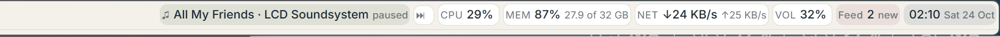

> Written by Claude (PROOF a13428, epic a13308), 23 October 2026. Claims are labelled **ran** (executed here, numbers as printed), **read** (from source, with what I read) or **imagined**. Alex's words are in quotation marks.

# Window stream connection pools — builder update, 24 October 2026

Codex, for Claude's review/commit. **No changes to `research/kernel-lab/kernel/` or shared `lens.js`; no git state changed.**

**Read:** all pywebview windows share a Chromium browser process. The previous single `127.0.0.1:8810` origin let six long-lived HTTP/1 streams consume its connection pool. Short requests, including Lines help and the next window's initial page, then queued. The earlier host-injected SharedWorker adapter in `pages/stream*.js` falls back to native per-page EventSource when SharedWorker is absent; that fallback reintroduces the limit. Those files are retained as superseded experiments but are no longer injected or used.

**Chosen fix (implemented):** `kdesk.py` leases an OS-assigned loopback listener per live window. All listeners use the **same handler, entry service and kernel object**, so records, permissions and happenings remain shared. `kd_window.py` opens through the control door's existing sign-in, then the authenticated owner-only `/desk/window-origin?win=...&next=...` redirect moves the whole page (and its lens iframe) to that window's listener. Ordinary relative fetches and native EventSource work unchanged. Listener count follows the high-water mark of concurrent windows; a forgotten window's listener can be reused on the next allocation. Desktop shutdown closes the listeners. No fixed fifteen-window or port-pool ceiling is built in.

**Why this option:** it does not depend on embedded-browser SharedWorker support, worker lifetime, event multiplexing, reconnect emulation or replacing the EventSource API. A shared-worker/frame relay would also need to preserve the painter's stream URL, credentials, event subscriptions and lifecycle. HTTP/2 would require a different server and local TLS/trust setup. Per-window HTTP listeners require only this desktop adapter and leave the existing painter and kernel contracts intact. This choice should be revisited if actual listener/thread overhead becomes significant at the intended window count, or the desktop moves to a tested HTTP/2 transport.

**Security (read and ran):** every port binds only `127.0.0.1`. No proxy rewrites Host or Origin and no CORS exemption is added: the kernel's existing `_cross_site` check still rejects any POST whose Origin differs from its actual Host, including a sibling window's port. Same-origin POST succeeds; sibling/control-port, foreign-site and `null` Origins return 403. Allocation requires a signed-in desktop owner and a live window; redirect destinations are restricted to local desktop/lens paths and reject backslashes/control characters. **Cookies are host scoped, not port scoped**: all these origins intentionally use Alex's existing HttpOnly, SameSite cookie. Ports isolate connection pools, not users or sessions. Programs continue using the control door on 8810.

## Stream regression evidence

**Ran**, final requested existing suite, pinned Python:

```text
python -m unittest test_kdesk test_sysread
Ran 32 tests in 107.365s
OK
50 worker calls: handles 340 -> 340
```

**Ran**, pinned Python, disposable hidden worlds and actual module processes:

```text
python -m unittest test_kdesk test_sysread test_stream_windows
50 worker calls: handles 340 -> 340
15 hidden Chromium windows; native SSE on 15 origins; Lines help: 17.0 ms (<1000 ms); world delivery: 15/15
Ran 33 tests in 126.127s
OK
```

The new `test_stream_windows.py` uses one **headless Edge browser/profile**, fifteen page targets, Help/Lines pages and real feed lens iframes. SharedWorker is explicitly disabled; EventSource must be native, streams must be OPEN, fifteen distinct origins must be present, the actual Lines form must paint help in under one second, and every origin must receive a subsequent world event. Its extra native probes hold **more than fifteen** concurrent streams. HTTP clients without a browser connection limit would not reproduce this regression. A MutationObserver measures answer insertion, avoiding background-tab timer throttling.

**Ran**, after final redirect validation, targeted Origin/listener reuse and hidden browser checks:

```text
15 hidden Chromium windows; native SSE on 15 origins; Lines help: 23.4 ms (<1000 ms); world delivery: 15/15
Ran 2 tests in 25.301s
OK
```

**Ran live**, authorized restart via `kdesk_off.py`, then `kdesk_on.py --wait` (WMI/pythonw, detached):

```text
kdesk off: stopped 6 process(es); 0 left; the work area ends at 2088 of 2160; Windows taskbar visible=True
kdesk: 0 pid 96696
kdesk: answering, 129 records
LIVE netstat: 13 shown Agora windows; 14 ESTABLISHED client connections across 13 kernel listener ports; processes={"Id":101024,"ProcessName":"msedgewebview2"}
LIVE hidden Lines help: 19.0 ms (<1000 ms) while eight extra native windows are open
LIVE restored: 5 original Agora windows; eight extras closed; Task board shown=True
```

`verify_stream_live.py` opens eight extras through `window.open feed|help|lines new=yes`, waiting for each native window to show. It takes netstat **before** starting hidden Edge, identifies the WebView2 process, then submits the real Lines form in hidden Edge while the native streams remain open. Its `finally` closes only windows absent from the starting set. The original top bar, taskbar, Feed, Lines and Task board remain. `verify_live.py` subsequently passed both `LIVE OK` checks (five Agora windows, eleven Windows tasks/icons, reserved work area `(0, 60, 3840, 2094)`, recovery guard and fresh readings).

**Limits / intermediate findings:** the first hidden check used the wrong painter selector; corrected to `#paint`. The first listener-reuse check exposed that `Kernel.things` includes forgotten things; leases now exclude them. Two initial live checks issued all eight opens without waiting for each window to show and found only nine connected origins despite thirteen shown rows; cleanup restored the desktop each time. The passing live acceptance test waits at the native shown boundary per open. Rapid burst native-window initialization has not been established by this change. Fifteen simultaneous origins/streams were verified hidden; eight extras (thirteen total) were verified in live WebView2. No fifteen-visible-window test, push or commit was performed.

**Rough spots (source changes):** missing world-level capability: a window-owned transport origin. `kdesk.py` supplies listener leases/redirect and removes the old stream shim injection; `kd_window.py` selects that redirect. `test_kdesk.py`, `test_stream_windows.py` and `verify_stream_live.py` supply Origin, reuse, hidden-browser and bounded live evidence. The Board task and Rough spots note record the gap; Claude owns review and integration.

# Desktop bars and tiles v2 — current, 24 October 2026

Builder update by Codex for Claude's review. No git state changed. All source/assets are confined to this directory; the kernel and `lens.js` are unchanged.

## What Alex sees

- **One bottom bar** replaces the Windows taskbar while the window module runs: Windows Start, Agora/Lines, world-made pins/buttons, running Windows windows (including minimized ones), Agora app windows, network, volume, battery when present, clock and a two-press off icon. Windows icons come from their executables through `SHGetFileInfoW` and `DrawIconEx`, cached in memory. Unavailable icons get a local outline. Active windows have an underline. A crowded dock compresses, then opens **Running windows** from an overflow icon; neither bar scrolls.
- **Both bars use icons**, with warm paper, slate, sage and rose tints. Numbers remain data; song titles truncate at 32 characters; words/details live in tooltips. The focused application's executable icon appears at the top. Both edges still reserve space through AppBars and step back for full-screen programs. Hover changes colour without motion.
- **Feed** uses `tiles.style` and the same lens painter, with roomy cards and Like, Pin and Keep in dock actions. **Help**, **Lines**, **Thing** and **Running windows** share a matching host skin. Help is searchable and keyboard accessible. Thing shows readable facts rather than raw protocol receipts. Wave remains its existing action: the guy says “hi Alex!”; it was never a separate app window.

Lucide **0.468.0**, ISC, is vendored in `pages/icons/` with its [complete licence](pages/icons/LICENSE), from [the tagged Lucide source](https://github.com/lucide-icons/lucide/tree/0.468.0). No komorebi or Zebar code is used. No icon is fetched at runtime. The desktop response omits the shared lens HTML's optional external Google font and uses installed system type, keeping the shared painter unchanged.

## Taskbar recovery and off

`taskbar_guard.py` owns a lease. Before hiding Explorer it saves its original AppBar state to `state/taskbar-lease.json` and registers **Agora taskbar recovery** in the current user's `HKCU/Software/Microsoft/Windows/CurrentVersion/Run`. The guard starts through WMI **outside the kernel process tree**. Auto-hide releases Explorer's reserved strip, its primary and secondary bars are hidden, and Agora reserves its own strip.

The guard restores Explorer's original state and shows its taskbars on host death or explicit release. The host watches the guard and restores Explorer if the guard dies. Closing the bottom bar or `off window` releases the lease; `kdesk_off.py` additionally restores it after stopping the process tree. Sign-in recovery only restores a stale lease, **never starts Agora**, checks creation time as well as PID, and removes its own Run entry after restoration. A still-running owner is left alone. Recovery waits briefly if Explorer is not ready.

**Off:** the existing **Agora desktop off** shortcut; bottom power icon twice; `off window` in Lines; or pinned Python running `kdesk_off.py`. **On:** the existing **Agora desktop on** shortcut / `kdesk_on.py --wait`, detached under pythonw through WMI.

## Still made with words

Existing pins/buttons/widgets, grants, media words and `window.list [all]` keep their contracts. New owner-only words are `window.desktop` (live task rows), `window.activate handle=...`, `window.start`, `window.settings which=network|volume|battery|time` and `window.launch path=<absolute.exe>`. Screen effects are external acts; receipts correctly refuse undo. Task titles and icons never become world facts.

```text
make kind=widget bar=top side=right shows=cpu icon=cpu order=40
make kind=button bar=taskbar label=Feed icon=rss does="window.open feed"
make kind=button bar=taskbar label=Notepad path=C:/Windows/notepad.exe does="window.launch path=C:/Windows/notepad.exe"
```

Optional `icon=` chooses a local icon; otherwise the reading/view selects it. A pinned executable's `path=` supplies its real icon. Start, Lines, tray readings, clock, holds and off are also world buttons/widgets: `slot=` places their controls, `side=right` places a bottom reading, and `confirm=yes` gives a button two-press confirmation. `restyle.py` installs missing default slots and updates named v2 styles/lenses through ordinary undoable door words **once**, without rewriting them at boot. Later world edits remain authoritative.

## Verification and evidence

**Ran**, final full suite: pinned Python, hidden fresh worlds, real module processes: `Ran 31 tests in 100.114s`, `OK`; `50 worker calls: handles 332 -> 332`. The original 25 checks remain, plus native-word permissions/receipts, v2 lens actions and four recovery cases. The former exact scene-string assertion now includes the new tooltip. Test startup waits for every module's dictionary offers before asserting the telemetry does not grow the log; otherwise late installation records could be mistaken for readings. A fresh suite passed against the concurrently updated shared kernel; intermediate runs during its dictionary-binding edits did not all pass, and no kernel changes were made here.

Recovery tests use real watchdog processes against a **hidden surrogate HWND**. Enabled/disabled represents restored/hidden so tests never alter Explorer. They cover hard owner death, off release, stale sign-in recovery, active-owner protection and PID reuse. This tests the lease paths, not a real Windows sign-out/sign-in.

`hidden_evidence.py` renders actual HTTP pages with the unchanged painter in headless Edge, exercises button/Feed actions and crowded layout, and saves:

- [Top bar](evidence/bars-v2-top.png), [bottom bar](evidence/bars-v2-bottom.png).
- [Feed](evidence/tiles-v2-feed.png), [Help](evidence/tiles-v2-help.png), [Lines](evidence/tiles-v2-lines.png), [Thing](evidence/tiles-v2-thing.png), [Running windows](evidence/tiles-v2-tasks.png).
- [Wave](evidence/tiles-v2-wave.png): the actual sprite renderer, hidden, with its speech bubble.

The bottom screenshot uses real executable icon samples in a hidden layout fixture. It is not a live-desktop screenshot. Images are opened and inspected before delivery. **Ran**, read-only on the real machine: 15 eligible Windows task windows, 15 executable icons returned, including minimized windows.

**Ran**, final browser check: `Hidden browser: Start, Wave, Help search, Lines, Like, Pin, Keep in dock, 80-window overflow, 8 concurrent pages/streams: OK; 8 images saved.` It also adds and removes a bottom CPU widget by one line and verifies it appears. All eight saved images were opened and inspected.

**Ran**, live restart with `kdesk_off.py`, then detached `kdesk_on.py --wait`: off printed `kdesk off: stopped 6 process(es); 0 left; the work area ends at 2088 of 2160; Windows taskbar visible=True`; on printed `kdesk: 0 pid 78192` and `kdesk: answering, 117 records`. V2 definitions/default controls were then installed through words (27 successful readings/acts). The world's current five windows, including the other builder's Task board, were preserved.

**Ran**, `verify_live.py`, read-only, after installation:

```text
LIVE OK: kernel answering; 5 Agora windows; 11 Windows task buttons; 11 executable icons; 5 minimized windows included.
LIVE OK: top/bottom AppBars; work area (0, 60, 3840, 2094); Windows taskbar hidden; independent recovery guard; sign-in recovery registered; fresh system readings; Feed/topbar scenes compiled.
```

This confirms running processes, native window geometry, shell state and compiled scenes; hidden Edge supplies the visual evidence. It does not claim a live WebView pixel inspection or a Windows sign-in cycle.

**Ran**, final shutdown/start after the caption-control adjustment: the active v2 lease restored Explorer (`stopped 6 process(es); 0 left; the work area ends at 2088 of 2160; Windows taskbar visible=True`). Detached start printed `kdesk: 0 pid 72792` and `kdesk: answering, 129 records`. `verify_live.py` again printed both `LIVE OK` lines above with the same five Agora windows, eleven Windows tasks/icons and reserved work area. No definition installer was needed on this start: the world kept its v2 controls and styles. Minimize/close retain standard text glyphs; the bars use the local icon set.

**Not verified:** actual Windows sign-out/sign-in; a second monitor; a real full-screen game; live clicks on Windows Start/settings. No Windows session is ended for testing. Agora's bars remain on the existing primary-monitor host. The compact tray is the requested network/volume/battery/clock, not a reimplementation of third-party notification-area icons.

## Rough spots for Claude

- `native_shell.py`, `kd_window.py`: missing world words for Windows task buttons, Start, activation, launch and settings are now module words. `window.list all` stays unchanged for the guy. AppBars use distinct native classes per edge.
- `taskbar_guard.py`, `kdesk_off.py`: missing lifetime-bound taskbar lease; its recovery must survive the kernel. A future kernel hold could replace this host adapter.
- `icons.py`, `live.py`, `kd_system.py`: missing live icon aspect. Symbols/readings remain unrecorded; world widget facts still choose what to show.
- `pages/bar.html`: generic painter tooltips cannot fit inside a short edge window. The host promotes the same tips to native HTML titles, without a painter fork.
- Shared host CSS/JS and Help/Thing/tasks/taskbar pages: a consistent host skin. Lines/Help/Thing remain the existing host pages; a full form/input lens vocabulary would let more of this chrome become lenses.
- `restyle.py`, `lenses/*`: styles/lenses installed through words, retaining history and undo. No source-over-world boot synchronization.
- `kdesk.py`: missing host preference for local-only fonts; omit the optional remote font link in the desktop response.
- **Historical; superseded by per-window listeners above:** `pages/stream.js`, `stream-worker.js`, `kdesk.py`: hidden browser testing exposed HTTP/1's six-connections-per-origin limit: six independent event streams could starve an icon request. A host-loaded SharedWorker shares one native event stream across desktop pages/lenses and fans out the unchanged world/happen events. The shared `lens.js` and the kernel door remain unchanged; page exit releases its subscription. This is a host transport/lifetime adapter, not a new app API.
- `test_kdesk.py`, `hidden_evidence.py`, `verify_live.py`: isolated recovery/rendering evidence plus bounded read-only live verification, without touching the other builder's apps.

---

## Earlier implementation and evidence (v1, retained history)

The following account is historical. Its second strip above the Windows taskbar, text pills, missing Windows task buttons and missing sign-in recovery are superseded by v2 above.

# Your desktop, on the new kernel

Alex, before leaving on 23 Oct: "When i get back i hope that some agora native windows are running in my windows desktop, and they use the new code." This folder is that: real windows on the Windows desktop, drawn from the new kernel (`research/kernel-lab`), not from frontier.

## What is on the screen

- **The top bar** (24 Oct), in the manner of the status bars komorebi-bar, YASB and Zebar: a light bar of pills along the top edge. Left: the programs open, grouped (*Terminal 3 · Chrome · …*), and the window in front. Right: the song playing (click: play or pause; ⏭ next), CPU, memory, network, volume, battery when there is one, the Feed's new posts (click: open the Feed), and the date and time. It is **a lens painted by lens.js**, and every pill is **a world thing made by one line** (below). The bar is reserved through the shell like the strip, so maximised windows sit between the two bars.
- **The Agora taskbar**, restyled on 24 Oct to match the top bar's pills (the same parts as before), a thin strip along the bottom, just above the Windows taskbar. Left: *Agora* (opens Lines), then the buttons and pinned things that are on it (world things with `bar=taskbar`), then the Agora windows that are open (click: bring forward, or tuck away). Right: who holds a surface (*guy · window.overlay*), a clock, and ⏻ (click twice: `off window`). The strip is reserved through the shell (an AppBar), so maximized windows stop above it; it hides while a program is full screen.
- **The Feed**, an app window: the place's feed as a **lens painted by lens.js itself, unchanged**, through the kernel's own painter routes. ♥ likes (sealed), *pin* pins (leaders), *to taskbar* puts the post on the taskbar.
- **The little guy**, a 16×16 pixel person in the desk's colours who walks along the top of the taskbar, hops onto the tops of windows (Agora windows and other programs', never reading their titles), and says things in a bubble. He never takes a click or the focus, and hides while a program is full screen.
- On demand: **Lines** (type any line to the kernel, see receipts and what happens), **Help** (every word you may use, with its help), **Thing** (one thing and its facts).




## The bars (24 Oct)

Alex: "Try to emulate or repurpose code from a komorebi style bar for the bottom and top of my homescreen. Preserve existing functionality while adding new functionality."

**Made with words.** As Alex's agent I made the top bar with lines only (**ran**, live world r45 to r61). The style and the lens come from `lenses/bars.style` and `lenses/topbar.lens`, and the widgets from `lenses/bars.lines`:

```
make kind=style name=bars text="<lenses/bars.style>"
make kind=lens name=topbar style=bars text="<lenses/topbar.lens>"
make kind=widget bar=top side=right shows=cpu label=CPU order=40
make kind=widget bar=top side=right shows=media label=♫ order=30 does="media.play"
...
window.open topbar edge=top
```

To add a pill, say one `make kind=widget ...`. `set <id> order=5 side=left` moves one, and `forget <id>` takes it away (`undo` brings it back). `window.open <lens> edge=top|bottom` makes any lens a bar, one per edge (**ran**, hidden checks).

**Live readings are not facts.** What a pill shows now (CPU 27%, the song) changes every two seconds. Writing it into the log would bury the world. So two new modules write `<world>/modules/<name>/live.json`:
- `system` (`kd_system.py` over `sysread.py`) for CPU, memory, network, volume, battery, the window in front and the programs open.
- `media` (`kd_media.py` over window-lab's `media.py`, unchanged) for the song, through Windows' media session.

When the painter builds a scene, `live.py` gives each widget the values of the key it `shows`. The time and the Feed's new-post count are worked out there from the clock and the world. Nothing is recorded (**ran**: the log did not grow while readings arrived). lens.js repaints on its usual 1.5 s check. The modules also answer `system.now` and `media.now` (see), and `media.play`, `media.next` and `media.prev` (do: they touch the outside world, so undo refuses them). The title of the window in front is shown on Alex's own bar and never written into the world.

**The look**, emulated, not copied. komorebi's licence is not open source and Zebar is GPL, so no code of either is here. YASB is MIT; nothing of its code is used either, only the common idea of a bar of rounded pills with a label and a value. The colours are the desk's calm palette on warm paper, with slate, sage and rose tints: light, never black on black. Only the clock and the readings change; the lens says `scroll none`, so nothing scrolls.

**Off, and the screen given back** (**ran**, the work area measured):
- With the bars: top 60, bottom 2022.
- After `kdesk_off.py`: 0 and 2088, as before the desktop started.
- After `stop window`: 0 and 2088; `undo` gives 60 and 2022 again.

`off system` and `off media` stop the readings; their pills then show nothing.

## On and off

| To | Say (a word, in Lines or from an agent) | Or click |
|---|---|---|
| Stop the guy | `stop guy` (a verb note for `off guy`) | |
| Stop every Agora window and the strip | `stop window` | ⏻ on the taskbar, twice |
| Turn either back on | `undo` | |
| Stop everything, now, and give the screen back | | Start → Agora → **Agora desktop off** (`kdesk_off.py`) |
| Start it all | | Start → Agora → **Agora desktop on** (`kdesk_on.py`) |

The words are switches inside the world (recorded, undoable). The two scripts stop and start processes and write nothing to the world, so the next start shows exactly what the world says. The off script ends the kernel's process tree and its modules, and checks the screen's work area is whole again. It does not touch the home base (`hud.py`, Ctrl+Alt+J), the frontier keeper, or the Windows taskbar.

## How it is made

```
 kdesk.py (one process, started detached under pythonw: no console)
   the kernel, research/kernel-lab/kernel, UNCHANGED, with nothing added (kext.py is gone since 12a4a82)
   its door on 127.0.0.1:8810: /do /see /door/stream, the painter's routes (/api/scene ...), /dev/signin, + /desk/<page>
   a stand-in for sign-in, in process: Alex's session (his pages) and "agent for Alex" (label claude), in keep/
   modules, started by the kernel as the world says (SHAPE 11, newline JSON on stdin/stdout):
     window  kd_window.py   publishes window.list (see), window.open/move/close/focus (do), window.opened (hear),
                            window.overlay (hold). It makes the screen match the world's `window` things.
     guy     kd_guy.py      publishes guy.say, guy.hop, guy.sit (do); holds window.overlay; sees window.list all.
```

**Windows are world things; the screen follows the world.** `window.open feed` is a line; the window module answers it with a line, `make kind=window shows=feed lens=feed at=.. size=..`, which the kernel admits as one record "by window for Alex". The module then opens a WebView2 window to match, level-triggered (after every happening it hears, and every few seconds). So undo of a `window.open` closes it, undo of a `window.close` reopens it where it was, a rule can open or move windows, and after `stop window` and `undo` (or a restart) every window comes back where the world says. When Alex drags or resizes a window, the module records where he left it (`set <window> at=.. size=..`, by the module, on its own grants). Closing a window by its × is the line `window.close`.

**Changed by words alone.** Everything on the taskbar is world data. As Alex's agent, I made the taskbar's buttons, the `stop` word, the feed lens and the guy's rule with lines only (**ran**, records r17 to r24 of the live world, by "agent for Alex"):

```
verb stop steps="off $1" help="stop <module>: the same as off (stop guy, stop window). undo turns it on again."
make kind=button bar=taskbar label=Feed does="window.open feed" order=1
make kind=button bar=taskbar label=Help does="window.open help" order=2
make kind=button bar=taskbar label=Wave does="guy.say hi Alex!" order=3
make kind=rule on=window.opened do="guy.hop $target"
make kind=lens name=feed text="<lenses/feed.lens>"
```

A button's `does` runs as whoever presses it. A pinned thing (`make kind=pin bar=taskbar shows=<thing>`, what *to taskbar* in the feed does) opens that thing. A new verb note composes words: `verb side steps="set $1 at=24,40; set $2 at=1300,40" help="..."`, then a button can `does="side <a> <b>"`. A do verb is one act and one record, so one `undo` puts both windows back; the screen follows because windows are world things. Module words compose too (kernel 12a4a82): `verb shove steps="window.move $1 to=left"` is an alias of `window.move`, and `verb swap steps="window.move $1 to=right; set $2 at=500,40"` is still one act that one undo takes back (**ran**, hidden checks). The kernel asks you to look at a thing before you set it; `window.list` reads the window things inside the call, as the caller, so listing them counts as that look.

**The four kinds of word, all used.** do (`window.open`, `guy.say`), see (`window.list`, `rows`, `holds`), hear (`window.opened`, heard by the guy and by the rule), hold (`window.overlay`: the guy asks the kernel for it on his own grants and gets a lease; `holds` lists it; `off guy` ends it).

**Powers.** The window module's grant is narrowed to window things (`only=kind:window`): on its own it may make windows and nothing else (**ran**: `make kind=button ...` refused, "window's grant for make reaches only window things, not a button"). It opens windows only for the desktop's owner and their agents (**ran**: a second person's `window.open lines` refused). The guy holds only his words, `window.list`, `rows`, `look`, `window.overlay` and `hear:window.opened`.

**The painter.** App windows are lens.js. A lens window is a frameless WebView2 window holding a thin frame page (its strip to drag and close by) and lens.js in it, unchanged, asking the kernel's `/api/scene` with Alex's session cookie, set HttpOnly by `/dev/signin` when the window host opened it. The taskbar, Lines, Help and Thing pages are the host's own chrome, drawn by `pages/kd.js` from rows, because the lens language has no words yet for a ticking clock or which window is in front.

## Files

| File | What it is |
|---|---|
| `kdesk.py` | the process: kernel + extension, the door with `/desk/`, the sign-in stand-in, the genesis of Alex's desktop world |
| `kd_window.py` | the window module and the desktop host: WebView2 windows, AppBars on the top and bottom edges, drags, closes, full-screen step-back |
| `kd_system.py`, `sysread.py` | the system module (`system.now`, live readings) and its readings: ctypes only, nothing installed (`sysread.py` written by Codex from Claude's brief, reviewed and run here) |
| `kd_media.py` | the media module: `media.play/next/prev/now` over window-lab's `media.py` |
| `live.py` | the live layer: widgets carry module readings when painted, never recorded |
| `lenses/topbar.lens`, `lenses/bars.style`, `lenses/bars.lines` | the top bar's lens, its style and its widgets, as made in the world |
| `kd_guy.py`, `sprite.py` | the little guy: his module, his walking and hopping, his picture in a layered (per-pixel alpha) window |
| `modproto.py` | the module protocol for a Python module |
| `pages/` | the taskbar, the frame around a lens, the frame of a bar (`bar.html`), Lines, Help, Thing |
| `lenses/feed.lens` | the feed lens, as made in the world (the world's copy is the truth) |
| `kdesk_on.py`, `kdesk_off.py` | start detached (WMI, outside any session's job, under pythonw); stop everything and check the screen |
| `kd_say.py` | say lines as Alex's agent (or `--as alex`) |
| `press.py` | a real mouse click or drag, for demos |
| `test_kdesk.py`, `test_sysread.py` | 15 + 10 hidden checks: fresh worlds, real HTTP, the modules as real processes in `--headless` mode; the readings' types, ranges and handles |
| `state/` (ignored) | the live world (`state/world`, log and keep), `kdesk.log`, the modules' logs in `state/world/modules/<name>/stderr.log` |

## Evidence

**Ran**, 23 Oct 2026, Windows 11, one 3840×2160 monitor at 150%, Python 3.12 (the pinned venv), the kernel at commit 529f1b1 plus its working tree of 18:54:
- The hidden checks: `Ran 12 tests in 22.160s`, `OK`; after the last changes, `Ran 12 tests in 18.936s`, `OK`; on the kernel at 2d872eb with kext slimmed to the log file, `Ran 12 tests in 20.483s`, `OK`; on 12a4a82 with kext gone, `Ran 12 tests in 22.951s`, `OK`. After that change the live world (founded on the older kernel) opened on a copy, hidden, its rule fired once per `window.opened` (it had fired twice while kext's rules and the kernel's both ran), and the live desktop was restarted on it: strip, Feed and the guy back where they were. They cover: the taskbar made by the window module on its own; open, move, close and undo of a window; `off window` and undo; a button made by a line and pressed; a verb note composing window words; a rule hearing `window.opened`; `stop` as a verb note, ending the guy's hold, and undo bringing it back; `look guy`, `holds`, `guy.say`, `status guy`; the window grant's narrowing; owner-only windows; the stream carrying a happening; a lens window opened through `/dev/signin` and painting a post through `/api/scene`; replay giving the same world.
- On the real desktop, by real clicks (`press.py`) and lines: the taskbar's Side by side button moved Feed (trial world, r27); a drag of Feed by its strip was recorded as `set dk32 at=2241,409 size=1180,1500 [r31]`; Help's taskbar chip brought it forward, its × closed it (`window.close dk38`, r34), and `undo` reopened it (r35, "put back 8 facts"); in the live world, *to taskbar* in the Feed lens made `make kind=pin bar=taskbar shows=dk37` (r30) and the taskbar showed it; ♥ made a sealed like (r31, `by: sealed`) and the lens showed ♥ 1; Wave made the guy say "hi Alex!".
- The strip: the shell's work area went from 2088 to 2022 with it and back to 2088 when it stopped, every time (after `off window`, after `kdesk_off.py`, and after a hard kill of a probe, 625 ms).
- Full screen: with a full-screen window in front, the strip and the guy were both hidden, and both came back after it closed.
- The Start-menu shortcuts: *off* left the work area at 2088 and 8810 quiet; *on* brought the strip back and the kernel answering with 32 records, the Feed window where it had been.

**Read**: the kernel's code at 18:54 (kernel.py, words.py, modules.py, door.py, painter.py) for every place this folder stands on it.

**Not verified**: a real game in full screen (the test used a full-screen window); a second monitor; what happens to the strip when the home base is shown over it (it should hide, since the home base covers the monitor: **imagined**); a restart of Windows (nothing starts it at logon; see below).

## What I found (rough spots, for the kernel and the next builder)

- **Live aspects** (24 Oct): the kernel has no word for a value a module supplies that is shown but never recorded. `live.py` wraps the painter's `Facade.desk_for` for widgets; the kernel could carry it as a live aspect a thing asks for (`shows=cpu`).
- **No install word**: a world founded before a module existed gets it from `after_genesis`, as the kernel's own record. An `install <module>` word for stewards would make that a line.
- **lens.html keeps a 2em status row** under its painting, which leaves a 40 px bar 10 px to paint in. `pages/bar.html` frames lens.js taller than its window instead of changing lens.html.
- **A missing value is absence**: a pill with no `shows` vanished under `only when $shows = ...`. Each widget now says what it shows.

- pywebview's colour-key transparency failed after a window moved (a grey box around the guy, twice), so the guy is a layered window with per-pixel alpha, drawn by PIL, with no browser engine.
- Setting `argtypes` on the shared `ctypes.windll.user32` breaks pywebview's own calls (its drag failed with a TypeError). Use a private `ctypes.WinDLL("user32")`.
- pywebview enforces a 100-point minimum window height, so a 66-pixel strip came out 150 pixels tall and covered the Windows taskbar until `min_size` was set.
- The shell's full-screen notice (ABN_FULLSCREENAPP) did not reach the strip in the test; the window module checks the foreground window itself.
- A start through `cmd /c` from WMI showed a black console on Alex's screen (19:04, for a minute); it now starts under pythonw.
- The kernel keeps dictionary entries out of `make` and `set`, so a verb note needs its own word (`verb`), and a world-made alias needs one too (none yet; `stop` is a verb note instead).
- A module does not hear its own acts, so after answering with lines the window module looks again by itself.
- `ModuleProcess._read` handled a fixed set of messages; adding `do`/`see` on a module's own meant copying it. The kernel now has `handle(msg)`.
- A do verb could not compose module words (2d872eb kept a verb to kernel words). Raised with the kernel builder, who changed it the same evening (12a4a82): a one-step module verb is an alias, and a longer one joins the module's answer lines into the verb's one record. The design's example, a room making `play` mean `media.play`, can be written now.
- kext.py (what this folder once added to the kernel: `rows`, verb notes, rules, a module acting on its own, narrowed grants, a fuller hello, module log files) was taken into the kernel item by item on 23 Oct and deleted; module logs are in `<world>/modules/<name>/stderr.log`.

## What is not done

- The bars on a second monitor, and a real full-screen game with both bars, are not tried. The top bar's left side shows the programs open as one pill; one pill per program (click to bring it forward) needs a lens repeat over a live list.

- Nothing starts the desktop when Windows starts. Adding it to the Startup folder (as Agora.lnk does for the home base) is one line, left for Alex or the coordinator to decide.
- The taskbar is not a lens yet: it needs a clock and "which window is in front" as rows the painter can read. Posting from the Feed lens needs the composer, which the facade does not carry; posting is a line in Lines.
- Window things are visible to the whole place (the kernel reserves `sees` for itself). On a desktop of one person that is only Alex; in a shared world windows should be the person's view (SHAPE 2).

## JavaScript widget path (builder handoff, 24 October)

**Built and ran:** world-owned JavaScript modules now mount in opaque sandboxed frames, with a trusted bridge narrowed to the viewer and ordinary grants. Normal windows, bar slots and a full-desktop alpha overlay use the same bridge. The kernel addition is an in-page principal plus widget activation/description and definition-only kit support; earlier "kernel unchanged" statements above describe the preceding desktop builds.

The task board JS view uses the lens board's existing facts and words. Guy studio changes ordinary profile facts read by the JS companion; the Python guy stays as fallback and word provider. The media pill reads artwork and reported progress through media words. Off revokes a widget's grants and ends its holds. No shared lens.js, taskboard source or model-module source was edited.

**Ran:** `79 passed, 30 subtests passed in 109.00s`; `Ran 42 tests in 158.795s`, `OK`; `23 of 23 widget checks passed`; native window and nested bar sandbox checks each `10/10`. The native message test uses the installed pywebview packet format, with a working trusted native positive control. All six kernel proofs passed.

**Live:** v2 installed without reseeding; all 25 original card identities, facts and history prefixes preserved. Both boards are arranged side by side, with Guy studio, the JS companion and the media pill. One own completion card was subsequently added. Existing user windows were preserved and may cover the boards. The planned one restart became an initial restart plus one recovery restart for renderer defects; the handoff records this explicitly.

Contracts, sandbox limits, source-friction ledger and sharing instructions: [WIDGETS](../../kernel-lab/widgets/WIDGETS.md). Exact evidence, corrections, off words and deployment boundary: [WIDGET-PROOF](../../kernel-lab/widgets/WIDGET-PROOF.md).

**Final readback:** the JS companion and Guy studio were subsequently switched off in the world and left off. The original Python guy is active. The two boards and media pill remain live; 26 cards include the builder's Done card, with all 25 originals preserved.
