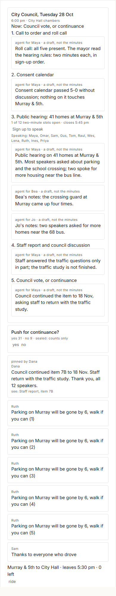
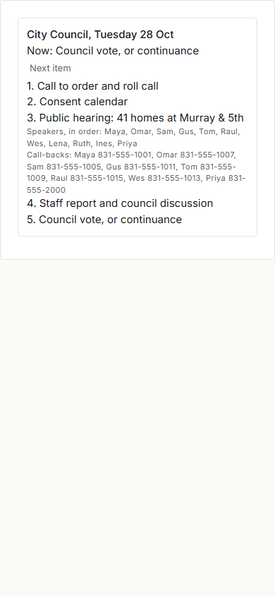

> Written by Claude (kernel story, Board a13310), 23 October 2026, for proof card a13431. What the first slice of Council night shows, labelled **ran** (executed here, numbers as printed), **read** (from source) or **imagined**. The kernel is described in [[SHAPE]] (section 17 is its contracts as built) and its first evidence is in [[SKELETON]].

# Council night, the first slice

A Tuesday council hearing on 41 homes at Murray & 5th, run end to end on the new kernel. Forty neighbours, three of their agents and two Node modules (agenda, tally) share one world over real HTTP on loopback. The pages are the desk's own `lens.js`, unchanged, painted from kernel things through the facade. Nothing appears on Alex's screen: the pictures come from headless Chrome.

**Imagined:** the people, their words, the agenda (`modules/agenda/agenda-oct28.json`), the summaries the agents post (written by the script; no model is called), and the staff report's address (example.org). **Ran:** everything below.

```bash
C:/Projects/Agora4/.venv/Scripts/python.exe src/agora/proof/council_night.py --shots
C:/Projects/Agora4/.venv/Scripts/python.exe -m pytest -q src/agora/tests     # runs it too, without pictures
```

## The evening

| When (the night's clock) | What happens | How it is done |
|---|---|---|
| 1 pm | 40 neighbours sign in through the sign-in seam; Maya, Bea and Jo each open an agent ("notes"). Alex makes Dana a leader of Council watch, an open group. | `/keep/account`, `role` |
| 1 pm | Dana links the staff report and loads the posted agenda | `make kind=research …`, `agenda.load in=<Council watch>`: the module answers with six `make` lines joined by `as=`/`$m`, admitted as one record by agenda for Dana |
| 3 pm | Three drivers offer carpools from map points; twelve riders press "ride" at once for nine seats | `make kind=carpool … lat= lon=`, presses on the painted page |
| 3 pm | Sixteen neighbours sign up at once for twelve two-minute comment slots; half type a phone number for a call-back | `claim <item> [phone=…]`, typed and pressed |
| 5:50 pm | Sign-up closed at 5:45: a free seat is refused | `closes=2026-10-29T00:45Z` on the item |
| 6 pm | Thirty phones open the stream and follow "Now:" while Dana presses Next on the floor page | `/door/stream`, then `/api/scene` with `have=` (one redraw at a time, as lens.js does) |
| the hearing | A sealed pulse poll, "Push for continuance?"; forty vote at once | `make kind=poll options="yes no"`, `vote` |
| each item | A neighbour's agent drafts a summary, labelled as the agent's | `make kind=summary about=<item>` from an agent's session |
| item 4 | Dana and Alex press Next on the same painted page at once | `agenda.next <meeting>` from the floor lens |
| 7:30 pm | The outcome, pinned in the feed with the staff report linked | `post … about=<report> in=<Council watch> as=o; pin $o`: two records from one line |

## The checks

**Ran**, 23 Oct 2026, Windows 11, Python 3.12 (the pinned venv), Node v25.6.1. `21 of 21 checks passed · 144 records`, on the evidence run and on the three runs before it, once the faults below were fixed. The full output is [`evidence/council-night.json`](evidence/council-night.json).

| Check | What was seen |
|---|---|
| the agenda module brings the agenda in as one act | 1 record, 6 things, by the agenda module for Dana; Maya's `agenda.load` refused: "is for leaders of Council watch" |
| twelve riders press for nine carpool seats at once | 9 taken, 3 told "sb84 is taken (3 seats, all claimed)" |
| sixteen sign up at once for twelve slots | 12 claimed, 4 told it is taken; a second sign-up refused "once each"; an undo gave a slot back and the next neighbour took it |
| sign-up closes at a time of day | "sign-up for sb80 closed at 2026-10-29T00:45Z", with a seat free |
| speakers' phone numbers are seen only by leaders | absent from a neighbour's `look` and from both of their pages; present in Dana's `look` and on her floor page |
| the feed is a slow lane | Ruth's sixth post: "you have said post 5 times today" |
| forty vote at once in a sealed poll | yes 32 · no 8, 20 typed and 20 pressed, every one counted |
| no record and no view says who voted how | 40 vote records, all `by: sealed`, none holding a voter's id; `look` shows counts only |
| one vote each; undo lets you change yours | a second vote refused; Maya undid hers and voted the other way; still 40 votes |
| two leaders press Next at once | one moved the meeting one item; the other: "stale: sb77 changed since it was painted (now, r140)" |
| a neighbour's Next is refused | "agenda.next is for leaders of Council watch" |
| agents' summaries are labelled as agents | 7 summaries, each by an agent for its person; the page says "agent for Maya · a draft, not the minutes" |
| thirty phones follow every "now speaking" | 5 moves × 30 phones, 0 missed; seen p50 191 ms, p95 342 ms, max 388 ms after the press |
| the outcome is a pinned announcement | two records from one line; first in a neighbour's feed; painted "pinned by Dana … see: Staff report, item 7B" |
| a neighbour may not pin; tally reads the feed as Sam may | refused; `tally.top 2` answered |
| replaying the log gives the same world | 144 records replayed, snapshot equal |

Timings on the evidence run: 114 acts over HTTP, p50 20.9 ms, p95 82.7 ms (typed p50 18.4, pressed p50 20.9); 381 page redraws by the thirty phones; the whole evening 26.8 s. The follow latency varies between runs: p50 548 ms and p95 1,091 ms on an earlier run of the same script, 191 ms and 342 ms on this one. Every redraw rebuilds the reader's whole world through the desk's compiler under one lock, so thirty phones queue behind each other; that is the cost to watch (**read**, `painter.py`; the variance is **ran**, its cause is my reading).

The pictures, a phone's width (390 px): a neighbour's page, drawn tall so one picture holds all of it, and Dana's floor page.

 

## What it found

Faults in the kernel, fixed while running it (each a world-level word that was missing or wrong):

1. **`leaders` in a who-sees rule meant only the place's leaders.** The hearing's own leaders could not see their speakers' call-back numbers. It now means the leaders of the thing's groups and those above them, as `may` already did. Sign-in answers, which belong to no group, still go to the place's leaders.
2. **A leader of the place is a steward.** Making the floor reporter a leader of Seabright would have let her switch modules off and undo anyone. So the night runs in an *open* group: everyone in the place sees its things and counts as its member, and its leaders are appointed. That is a new rule, and it may be the wrong one: a public channel where anyone may also act is two decisions in one word.
3. **A module's act ignored what the press had seen.** Two leaders pressing Next on one page would have moved the meeting two items, because the module read the meeting fresh each time. A press's `observed` now also fences the lines a module answers with.
4. **A word with no target is decided at the place.** `agenda.next` with nothing named asked for leaders of Seabright. It now names the meeting it moves, which also says which group's leaders may.
5. **The door's listen queue was Python's default of five.** Twenty presses at once beside thirty open streams reset a connection once (WinError 10054). It is 128 now.
6. **`look <thing>` printed only the thing's kind.** It now prints the facts the reader may see.

Friction that stays, for the dictionary and the line language:

7. **Prose meets the line language.** A post containing `;` is split into two steps ("Council continued item 7B to 18 Nov; staff return…" ran "staff" as a word), and an apostrophe opens a quote that never closes. Neighbours write prose. Either a word that takes `<words>` should take the rest of the line as its words, or pages must always quote. I lean to the first.
8. **A page cannot know the time of day.** The "Sign up to speak" button stays after 5:45 and the press is refused with the reason. The lens language compares dates (`due<=today`), not times.
9. **A feed wants newest first.** `by` sorts ascending only, so the lens shows Ruth's oldest post first.
10. **The map is not painted.** Carpools carry `lat` and `lon`, but the desk's painter has no map role; the page lists them.
11. **`from` is a reserved fact** (a dictionary entry's), so a carpool says `pickup=`. A kind's own words should not collide with the kernel's; reserved names may want a prefix.

## Not shown here

- *hear* and *hold*: the phones follow through the record stream, not through happenings; no module holds anything.
- A real phone, a real network, the Oregon box, or more than one process (**imagined** beyond what was measured).
- The entry service itself: sign-in is the stand-in that speaks the frozen seam (the real one is tested in `test_skeleton.py`).
- Map pins as a painted map, hours as a lens term, and the 18 Nov follow-up meeting.

## Related documents

- [[SHAPE]]
- [[SKELETON]]
- [[Communities and the Dictionary]]
