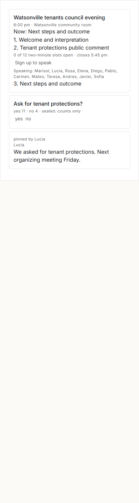
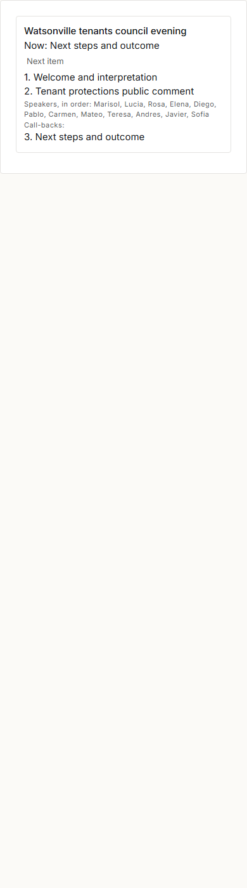

> Builder draft for Claude's review, 24 October 2026, story **The first kits** (Board a13319). Claims are labelled **ran**, **read**, or **imagined**. No staging, commit or push is part of this handoff.

# The first kits

**Imagined:** Seabright shares the tools its Council watch group uses. Watsonville Tenants Union takes them, keeps its own people and evening, and calls the preparation word `organize`, `preparar` and `organizar`. The people, decisions and agendas are scripted; no model is called.

**Read:** [Communities and the Dictionary](../../community/Communities%20and%20the%20Dictionary.md) says a kit is a group's kinds, words, views and rules copied together, and that sharing is posting and taking is placing. [SHAPE section 17](../SHAPE.md#17-the-contracts-as-built-kept-current-for-the-builders-who-depend-on-them) is the implementation contract. The proof uses the existing Council night scenario and HTTP actor helpers, then keeps its disposable source world alive for the transfer. Its existing 21 assertions remain intact. The two council lenses now belong to Council watch, so gathering that group's definitions includes them.

**Ran:** the proof first runs Council night with its forty neighbours, private call-back numbers, sealed votes, posts and agents. It adds three composed words, two kind declarations, a style and an acknowledgement rule through ordinary HTTP lines. Council watch becomes one kit of **11 definitions** and is posted in Seabright's feed. Watsonville has a separate directory, `wt` tag, keep, entry stand-in, accounts and loopback door; **15 local people** use the copied tools. Source evidence is embedded in [`evidence/kits.json`](evidence/kits.json), alongside numbered checks, origins, actor receipts and screenshot results.

```powershell
C:/Projects/Agora4/.venv/Scripts/python.exe src/agora/proof/kits.py --shots
C:/Projects/Agora4/.venv/Scripts/python.exe -m pytest -q src/agora/tests
```

The evening, **read** from [kits.py](kits.py):

| Moment | Words through the HTTP door | Check |
|---|---|---|
| Gather and share | `kit <group>`; `post ... about=<kit>`; `look <kit>` | All five definition classes; ordinary feed post |
| Take | `take bundle=<quoted JSON> in=<group>` | Eleven new definitions in one record, each with origin |
| Check privacy | Inspect destination state and copied definition facts | No source people, posts, polls, claims, phones or votes arrived |
| Inspect module words | `help agenda.load`, `help agenda.next`; attempt `agenda.load` | Both report unbound; invocation refuses; no module or grant imported |
| Adapt locally | `rename <prepare entry> word=organize aliases="preparar organizar"` | Three local names; source unchanged |
| Grant locally | Group leader's `module` refused; local steward supplies argv and grants | Explicit local authority; copied entries bind without losing local edits |
| Start the evening | `preparar agenda-watsonville.json` | Watsonville meeting and three locally created items |
| Speak | Fifteen concurrent `speak <item>` requests | Twelve admitted, three refused at capacity |
| Vote | Fifteen concurrent `pulse <poll> yes|no` requests | Yes 11, no 4; fifteen sealed records; repeated vote refused |
| Finish | Three `agenda.next` acts; `post ... as=o; pin $o` | Local outcome pinned by Lucia; copied rule reads it as its local maker |
| Read and recover | Both copied lenses; fresh `Kernel` instances over both folders | Local pages; exact fact-for-fact replay in both |

**Ran:** the headless phone pictures were captured and visually inspected. The neighbour page shows Watsonville's agenda, twelve speakers, sealed totals and Lucia's pinned outcome. The floor page shows the same local agenda and speakers. Screenshots use disposable browser profiles and free loopback ports; no window appears on Alex's screen.

**Ran:** the full suite printed `56 passed, 30 subtests passed in 93.44s (0:01:33)`, exit 0. The screenshot proof printed `23 of 23 checks passed`, exit 0, including its original source evening's `21 of 21 checks passed`. Both logs replayed exactly: **153 Seabright records**, **54 Watsonville records**. The run without screenshots has 21 kit checks; the two screenshot assertions bring it to 23.




## The small contract

**Read:** [kernel/kits.py](../kernel/kits.py) uses a closed field schema for `word`, `lens`, `style`, `rule` and `kind` definitions. Group-scoped definitions are gathered, along with referenced module entries. Memberships, maker identities, contacts, claims, votes, posts, module configuration and grants are never copied. References to gathered definitions remap in one pass; kernel-entry references bind to the destination's own kernel entries. A reference outside that closure refuses the kit rather than pulling live data along. The source world's first-record digest plus definition id is the copied definition's origin. A later copy records its immediate source.

**Read:** a kit is immutable through ordinary `make`/`set`, and each copy's `origin` is kernel-owned. Taking validates the same schema before minting and checks collisions before commit. Each copied rule's maker is the local taker, so rules use local rights. A take may be undone as one record until later edits or uses conflict. Module words use their existing `from=module:<name>` and `bound` values, and `help` reports their unbound state. The local steward separately supplies the executable command and grants with `module`; no executable command travels in the bundle.

**Read:** [test_kits.py](../tests/test_kits.py) covers independent edits and aliases, local and cross-world taking, undo, origin protection, replay, internal and kernel reference remapping, malformed and forged bundles, live-data references, name collisions, permission refusals and absent-module help. Its final test runs the entire two-community HTTP proof. No existing test assertion was weakened.

## Rough spots: source edits and missing world words

| Source | Missing world capability | Change |
|---|---|---|
| `kernel/kits.py` | Gather definitions and place independent copies together | `kit`, `take`, closed portable schema, reference remapping, origin |
| `kernel/kits.py` | Give a local word local names | `rename`, with group authority, fence and collision checks |
| `kernel/kits.py` | Grant and run a module after receiving its entries | Steward-only `module`, explicit local argv and grants; existing `off` is its stop switch |
| `kernel/words.py` | Discover these capabilities through the dictionary | Entries and help; protect kit/origin fields; module help says unbound |
| `kernel/kernel.py` | Make a kit as the named group's own leader | A group/place target supplies its own scope, rather than its parent's |
| `kernel/kernel.py` | Call a copied module alias in its group | Single-step module aliases retain the caller's group when forwarding |
| `proof/council_night.py` | Reuse the actual source evening | Optional supplied/retained Night; group-owned lenses; original checks preserved |

## Limits and handoff

**Read:** cross-world transport here is a caller carrying the portable JSON value between two authenticated doors. There is no remote import URL, federation, signature verification, automatic dependency installer, update/merge subscription or conflict-resolution UI. Names that collide refuse; choose another group or adapt definitions before taking. The schema deliberately excludes executable module code and unfamiliar definition kinds. Kind declarations are ordinary `kind=kind` things; they do not enforce instance schemas.

**Read:** the definition/data boundary is structural. It excludes people's instance records and refuses references to them. It cannot recognise personal information someone deliberately writes into definition help or lens text. Origin is attribution supplied by the bundle, not proof of authorship. Shared rules run with their taker's rights, so taking a rule is granting it those local rights. No untrusted-module sandbox was added.

**Imagined:** a real phone, remote network, production community, unfamiliar model discovering the kit, or someone maliciously disguising data as definition prose would require further evidence. A failure there would narrow this conclusion; this proof establishes the scripted loopback transfer and local evening only.

**Read:** live Board updates and live Rough spots notes are left to Claude because this task permits changes only under `src/agora/`. This file is the review handoff for the story, with the source edits logged above. No live-world deployment was performed. The source council evidence JSON was also regenerated during the first proof attempt; the final kit proof embeds its own source evidence instead of overwriting it again.
